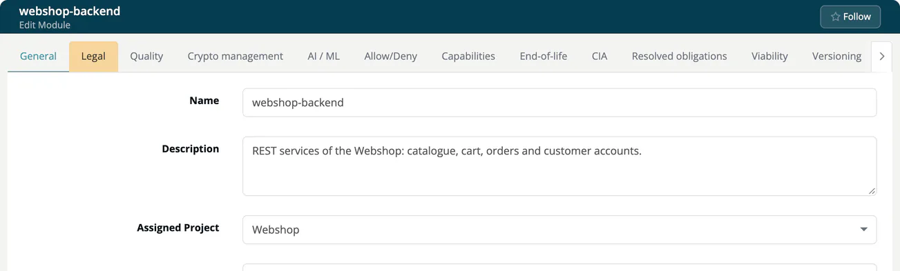

# Module Settings Permission Matrix

Field-level permissions for the **module** settings tabs of ***TrustSource CE***. For the codes, role abbreviations and the source of the tables, see the [project settings matrix](06-settings-permission-matrix.md#how-to-read-the-tables).

Roles are combined with **OR**. See [Permission Model](03-permission-model.md).

> [!NOTE]
> Infrastructure modules hide the tabs Quality, Crypto management, AI / ML, Allow/Deny, Capabilities, Custom components, History and Export SPDX, whatever the rights say. The **AI / ML** tab has no rights of its own: it is shown together with Crypto management and follows the `encryption` rights.

## Module settings: base rights

Each heading is a tab in the module settings. The columns are Dev, CM, PM, Mgr, AA, CCM and CSM.

### General

| Setting | Dev | CM | PM | Mgr | AA | CCM | CSM |
|---|---|---|---|---|---|---|---|
| name | `rw` | `r` | `r` | `r` | `r` | `r` | `r` |
| version | `rw` | `r` | `r` | `r` | `r` | `r` | `r` |
| description | `rw` | `r` | `r` | `r` | `r` | `r` | `r` |
| projectId | `rw` | `r` | `r` | `r` | `r` | `r` | `r` |
| tags | `rw` | `r` | `rw` | `r` | `r` | `r` | `r` |
| leanix | `r` | `r` | `r` | `r` | `r` | `r` | `r` |
| moduleIdentifier | `r` | `r` | `r` | `r` | `r` | `r` | `r` |
| architectureType | `r` | `r` | `r` | `r` | `r` | `r` | `r` |
| relatedUsers › defaultProjectManager | `r` | `r` | `rw` | `r` | `r` | `r` | `r` |
| relatedUsers › defaultComplianceManager | `r` | `r` | `rw` | `r` | `r` | `r` | `r` |
| relatedUsers › members | `r` | `r` | `r` | `r` | `r` | `r` | `r` |
| properties › privacy | `r` | `r` | `r` | `r` | `r` | `r` | `r` |

### Legal

| Setting | Dev | CM | PM | Mgr | AA | CCM | CSM |
|---|---|---|---|---|---|---|---|
| settings | `r` | `r` | `r` | `r` | - | - | - |
| project | `r` | `r` | `r` | `r` | - | - | - |
| wizard | - | - | - | - | - | - | - |
| import_template | - | - | - | - | - | - | - |
| import_project | - | - | - | - | - | - | - |
| propagate | - | - | - | - | - | - | - |

### Resolved obligations

| Setting | Dev | CM | PM | Mgr | AA | CCM | CSM |
|---|---|---|---|---|---|---|---|
| list | `r` | `r` | `r` | `r` | - | - | - |
| project | `r` | `r` | `r` | `r` | - | - | - |
| import | - | - | - | - | - | - | - |
| propagate | - | - | - | - | - | - | - |

### Viability

| Setting | Dev | CM | PM | Mgr | AA | CCM | CSM |
|---|---|---|---|---|---|---|---|
| viabilityConfig › enabled | `rw` | `r` | `r` | `r` | `r` | `r` | `r` |
| import | `rx` | - | - | - | - | - | - |
| warningThreshold | `rw` | `r` | `r` | `r` | `r` | `r` | `r` |
| violationThreshold | `rw` | `r` | `r` | `r` | `r` | `r` | `r` |
| minConfidence | `rw` | `r` | `r` | `r` | `r` | `r` | `r` |
| noInfoLevel | `rw` | `r` | `r` | `r` | `r` | `r` | `r` |

### Versioning

| Setting | Dev | CM | PM | Mgr | AA | CCM | CSM |
|---|---|---|---|---|---|---|---|
| versioningConfig › enabled | `rw` | `r` | `r` | `r` | `r` | `r` | `r` |
| jump | `rw` | `r` | `r` | `r` | `r` | `r` | `r` |
| import | `rx` | - | - | - | - | - | - |
| warningThreshold | `rw` | `r` | `r` | `r` | `r` | `r` | `r` |
| violationThreshold | `rw` | `r` | `r` | `r` | `r` | `r` | `r` |

### CIA

| Setting | Dev | CM | PM | Mgr | AA | CCM | CSM |
|---|---|---|---|---|---|---|---|
| settings | `rw` | `r` | `r` | `r` | `r` | `r` | `rw` |
| import | `rx` | - | - | - | - | - | `rx` |

### Capabilities

| Setting | Dev | CM | PM | Mgr | AA | CCM | CSM |
|---|---|---|---|---|---|---|---|
| settings | `rw` | `rw` | `rw` | `rw` | `r` | `r` | `rw` |
| import | `rx` | `rx` | `rx` | `rx` | - | - | `rx` |

### Crypto management (and AI / ML)

| Setting | Dev | CM | PM | Mgr | AA | CCM | CSM |
|---|---|---|---|---|---|---|---|
| settings | `rw` | `r` | `r` | `r` | `r` | `r` | `r` |
| import | `rx` | - | - | - | - | - | - |

### End-of-life

| Setting | Dev | CM | PM | Mgr | AA | CCM | CSM |
|---|---|---|---|---|---|---|---|
| settings | `rw` | `r` | `r` | `r` | `r` | `r` | `r` |
| import | `rx` | - | - | - | - | - | - |

### Quality

| Setting | Dev | CM | PM | Mgr | AA | CCM | CSM |
|---|---|---|---|---|---|---|---|
| settings | `rw` | `r` | `r` | `r` | `r` | `r` | `r` |
| import | `rx` | - | - | - | - | - | - |

### History

| Setting | Dev | CM | PM | Mgr | AA | CCM | CSM |
|---|---|---|---|---|---|---|---|
| analysis | `r` | `r` | `r` | `r` | - | - | - |
| scans | `r` | `r` | `r` | `r` | - | - | - |

### Allow/Deny

| Setting | Dev | CM | PM | Mgr | AA | CCM | CSM |
|---|---|---|---|---|---|---|---|
| whitelist_license_approve | - | - | - | - | - | - | - |
| whitelist_license | `rw` | `r` | `r` | `r` | - | - | - |
| whitelist_component_approve | - | - | - | - | - | - | - |
| whitelist_component | `rw` | `r` | `r` | `r` | - | - | - |
| blacklist_license | `rw` | `r` | `r` | `r` | - | - | - |
| blacklist_component | `rw` | `r` | `r` | `r` | - | - | - |

### Allowed vulnerability

| Setting | Dev | CM | PM | Mgr | AA | CCM | CSM |
|---|---|---|---|---|---|---|---|
| list | `rw` | `r` | `r` | `r` | `r` | `r` | `r` |

### Custom components

| Setting | Dev | CM | PM | Mgr | AA | CCM | CSM |
|---|---|---|---|---|---|---|---|
| settings | `rw` | `r` | `r` | `r` | `r` | `r` | `r` |

### Export SPDX

| Setting | Dev | CM | PM | Mgr | AA | CCM | CSM |
|---|---|---|---|---|---|---|---|
| export | `rx` | `rx` | `rx` | `rx` | - | - | - |

### Danger Operations

| Setting | Dev | CM | PM | Mgr | AA | CCM | CSM |
|---|---|---|---|---|---|---|---|
| delete | `rx` | - | - | - | - | - | - |
| delete_history | `rx` | - | - | - | - | - | - |

## Rights that depend on your relationship to the module

The tables above show the **base** rights. In the interface, three roles get different rights depending on how they relate to the module:

| Context | When it applies |
|---|---|
| **Default owner** | The Manager is the default project manager of the module, or the Compliance manager is its default compliance manager, or no such default is assigned. |
| **Member** | A Developer is listed in the members of the module. |
| **Non-member** | A Developer is not a member while the module has members. |

> [!NOTE]
> These contexts control what the interface shows and lets you edit. The server checks role and company only, so membership and default ownership are not a security boundary in TrustSource CE 1.0. See [Permission Model](03-permission-model.md#four-layers-of-checks).

The next tables list only settings where at least one context differs from the base. All other roles always have their base rights. A `·` means the context does not define the setting; the app then grants no access from that role.

### Context rights: General

| Setting | Dev base | Dev member | Dev non-member | CM base | CM default owner | Mgr base | Mgr default owner |
|---|---|---|---|---|---|---|---|
| name | `rw` | `rw` | `r` | `r` | `r` | `r` | `rw` |
| version | `rw` | `rw` | `r` | `r` | `r` | `r` | `rw` |
| description | `rw` | `rw` | `r` | `r` | `r` | `r` | `rw` |
| projectId | `rw` | `rw` | `r` | `r` | `rw` | `r` | `rw` |
| tags | `rw` | `rw` | `r` | `r` | `rw` | `r` | `rwd` |
| leanix | `r` | `rw` | `r` | `r` | `r` | `r` | `rw` |
| architectureType | `r` | `r` | `r` | `r` | `rw` | `r` | `rw` |
| relatedUsers › defaultProjectManager | `r` | `r` | `r` | `r` | `rw` | `r` | `rw` |
| relatedUsers › defaultComplianceManager | `r` | `r` | `r` | `r` | `rw` | `r` | `rw` |
| relatedUsers › members | `r` | `r` | `r` | `r` | `rw` | `r` | `rw` |
| properties › privacy | `r` | `r` | `r` | `r` | `rw` | `r` | `rw` |

### Context rights: Legal

| Setting | Dev base | Dev member | Dev non-member | CM base | CM default owner | Mgr base | Mgr default owner |
|---|---|---|---|---|---|---|---|
| settings | `r` | `r` | `r` | `r` | `rw` | `r` | `rw` |
| project | `r` | `r` | `r` | `r` | `rw` | `r` | `rw` |
| wizard | - | - | - | - | `rx` | - | `rx` |
| import_template | - | - | - | - | `rx` | - | `rx` |
| import_project | - | - | - | - | `rx` | - | `rx` |
| propagate | - | - | - | - | `rx` | - | `rx` |

### Context rights: Resolved obligations

| Setting | Dev base | Dev member | Dev non-member | CM base | CM default owner | Mgr base | Mgr default owner |
|---|---|---|---|---|---|---|---|
| list | `r` | `r` | `r` | `r` | `rw` | `r` | `rw` |
| project | `r` | `r` | `r` | `r` | `·` | `r` | `rw` |
| import | - | - | - | - | `rx` | - | `rx` |
| propagate | - | - | - | - | `rx` | - | `rx` |

### Context rights: Viability

| Setting | Dev base | Dev member | Dev non-member | CM base | CM default owner | Mgr base | Mgr default owner |
|---|---|---|---|---|---|---|---|
| viabilityConfig › enabled | `rw` | `rw` | `r` | `r` | `rw` | `r` | `rw` |
| import | `rx` | `rx` | `r` | - | `rx` | - | `rx` |
| warningThreshold | `rw` | `rw` | `r` | `r` | `rw` | `r` | `rw` |
| violationThreshold | `rw` | `rw` | `r` | `r` | `rw` | `r` | `rw` |
| minConfidence | `rw` | `rw` | `r` | `r` | `rw` | `r` | `rw` |
| noInfoLevel | `rw` | `rw` | `r` | `r` | `rw` | `r` | `rw` |

### Context rights: Versioning

| Setting | Dev base | Dev member | Dev non-member | CM base | CM default owner | Mgr base | Mgr default owner |
|---|---|---|---|---|---|---|---|
| versioningConfig › enabled | `rw` | `rw` | `r` | `r` | `rw` | `r` | `rw` |
| jump | `rw` | `rw` | `r` | `r` | `rw` | `r` | `rw` |
| import | `rx` | `rx` | `r` | - | `rx` | - | `rx` |
| warningThreshold | `rw` | `rw` | `r` | `r` | `rw` | `r` | `rw` |
| violationThreshold | `rw` | `rw` | `r` | `r` | `rw` | `r` | `rw` |

### Context rights: CIA, Crypto management, End-of-life, Quality

The same values apply to each of these tabs.

| Setting | Dev base | Dev member | Dev non-member | CM base | CM default owner | Mgr base | Mgr default owner |
|---|---|---|---|---|---|---|---|
| settings | `rw` | `rw` | `r` | `r` | `rw` | `r` | `rw` |
| import | `rx` | `rx` | `r` | - | `rx` | - | `rx` |

### Context rights: Capabilities

| Setting | Dev base | Dev member | Dev non-member | CM base | CM default owner | Mgr base | Mgr default owner |
|---|---|---|---|---|---|---|---|
| settings | `rw` | `rw` | `r` | `rw` | `rw` | `rw` | `rw` |
| import | `rx` | `rx` | `r` | `rx` | `rx` | `rx` | `rx` |

### Context rights: History

| Setting | Dev base | Dev member | Dev non-member | CM base | CM default owner | Mgr base | Mgr default owner |
|---|---|---|---|---|---|---|---|
| analysis | `r` | `r` | `r` | `r` | `rwd` | `r` | `rwd` |

### Context rights: Allow/Deny

| Setting | Dev base | Dev member | Dev non-member | CM base | CM default owner | Mgr base | Mgr default owner |
|---|---|---|---|---|---|---|---|
| whitelist_license_approve | - | - | - | - | `rx` | - | - |
| whitelist_license | `rw` | `rw` | `r` | `r` | `rwd` | `r` | `rwd` |
| whitelist_component_approve | - | - | - | - | `rx` | - | - |
| whitelist_component | `rw` | `rw` | `r` | `r` | `rwd` | `r` | `rwd` |
| blacklist_license | `rw` | `rw` | `r` | `r` | `rwd` | `r` | `rwd` |
| blacklist_component | `rw` | `rw` | `r` | `r` | `rwd` | `r` | `rwd` |

### Context rights: Allowed vulnerability

| Setting | Dev base | Dev member | Dev non-member | CM base | CM default owner | Mgr base | Mgr default owner |
|---|---|---|---|---|---|---|---|
| list | `rw` | `rw` | `r` | `r` | `rwd` | `r` | `rwd` |

### Context rights: Custom components

| Setting | Dev base | Dev member | Dev non-member | CM base | CM default owner | Mgr base | Mgr default owner |
|---|---|---|---|---|---|---|---|
| settings | `rw` | `rw` | `r` | `r` | `rwd` | `r` | `rwd` |

### Context rights: Export SPDX

| Setting | Dev base | Dev member | Dev non-member | CM base | CM default owner | Mgr base | Mgr default owner |
|---|---|---|---|---|---|---|---|
| export | `rx` | `rx` | `r` | `rx` | `rx` | `rx` | `rx` |

### Context rights: Danger Operations

| Setting | Dev base | Dev member | Dev non-member | CM base | CM default owner | Mgr base | Mgr default owner |
|---|---|---|---|---|---|---|---|
| delete | `rx` | `rx` | - | - | - | - | `rx` |
| delete_history | `rx` | `rx` | - | - | - | - | `rx` |

## Related

- [Project settings matrix](06-settings-permission-matrix.md)
- [Permission Model](03-permission-model.md)
- [Module Settings](../03-internal/02-modules/settings/index.md)
