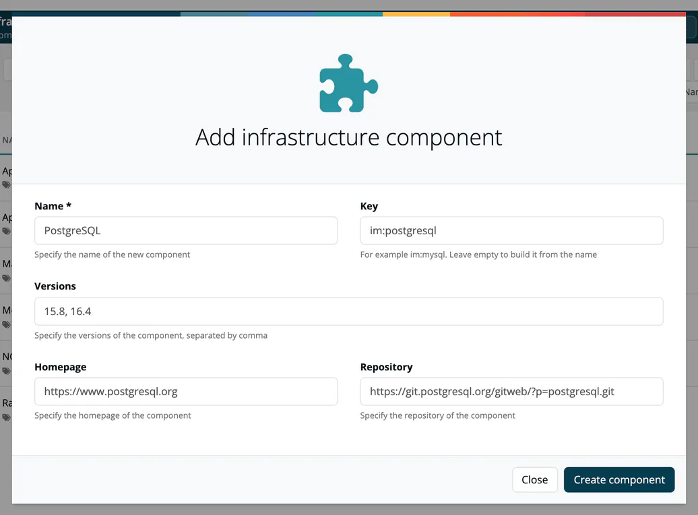

# Manage Infrastructure Components

> [!NOTE]
> **Required role:** Company component manager.

Infrastructure components describe the platform your software runs on: operating systems, base images, databases, web servers and message brokers. ***TrustSource CE*** ships with a set of common ones; as Company component manager you extend and maintain the catalog. Open **Knowledge → Infrastructure Elements**; everyone else sees the same list read-only (see [Infrastructure Elements](../05-knowledge/02-infrastructure-elements.md)).

## Add a component

1. Press **Add infrastructure component**.
2. Enter the **Name** (required) and optionally the **Key** (for example `im:mysql`; leave it empty to build it from the name), the **Versions** separated by commas, the **Homepage** and the **Repository**.
3. Press **Create component**.

## Edit a component

Select a component in the list, then **Edit**. The page has two tabs, **Info** and **Logs**.

On **Info** you maintain:

| Area | Fields |
|---|---|
| **Information** | Key and purl (read-only), **Category**, **Homepage**, **Repository**, **Issues**, **Release notes**, **Provider**, **Provider url**, **Provider address**, **Language**, **Declared licenses**, **Effective licenses**, **Concluded licenses**, **Declared copyright**. Crypto algorithms and AI / ML models are shown read-only. |
| Text panels | **Short description**, **Description**, **Comment**. |
| **Commercial terms** | **Right to re-sell**, **Right to distribute**, **Right to host/operate as SaaS**, **Right to modify**, each *unlimited*, *limited* or *no*. |
| **Versions** | See below. |

Changes are saved as soon as you leave a field or change a selection.

In **Versions**, enter new versions as a comma-separated list and press **Create versions**. Filter long lists with the version filter. To change several versions at once, select them (or use the select-all box), choose licenses, a license text URL and a copyright line, and press **Set to selected**. Changing the filter clears the selection, so a bulk change only reaches versions you can see.

**Logs** lists who changed what, with date, person, version and message.

## Remove a component

The header offers **Soft-delete**, which marks the component as removed, and **Revert-delete** to restore it. **Delete** removes it for good after a confirmation.

## Where it is used

**View used as Modules** on the list shows the modules of type infrastructure that use these components. See [Infrastructure modules](../03-internal/02-modules/03-infrastructure-modules.md).

## Related

- [Knowledge → Infrastructure Elements](../05-knowledge/02-infrastructure-elements.md)
- [Manage COTS Components](02-manage-cots.md)
