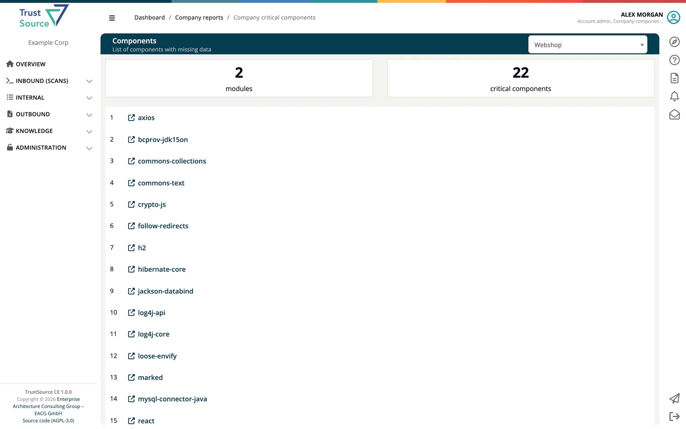

# Critical Components

> [!NOTE]
> **Required role:** Company component manager.

A **critical component** in ***TrustSource CE*** is a component whose catalog data makes the license assessment of every scan using it unreliable: a version **without licenses**, a license **without a key**, or **no repository URL**. Fixing these entries improves the results of all projects that use the component.

## Find components to fix

Open **Knowledge → Component Lake** and press **Critical components**, or open the **Components** tile under **Internal → Reports**. The report is titled **Components** (*List of components with missing data*).

1. Select a project at the upper right.
2. Read the counters **modules** and **critical components**.
3. Each entry names a critical component used in the project's modules. Click it to open its edit page in a new tab.

**Export as PDF** downloads the list.

To look beyond one project, search the [Component Lake](../05-knowledge/01-component-lake.md) directly; component pages mark incomplete license data with *Key missing* or *Key and Name missing*.

## Fix a component

The edit page works like the edit page of an [infrastructure component](01-manage-infrastructure.md#edit-a-component): set the **Declared**, **Effective** and **Concluded licenses**, the **Repository** (or **Sponsoring organisation** data) and the other information; changes are saved as soon as you leave a field. For the affected versions, select them and use **Set to selected** to assign license, license URL and copyright in one step. A version filter narrows long lists.

The edit page opened from the report shows the fields only. Opened with **Edit** from the component page in the Component Lake, it also has the tabs **Info** and **Logs**, and the header offers **Soft-delete** to mark a bad entry as removed and **Revert-delete** to restore it.

Licenses missing from the catalog can be added under [Knowledge → Licenses](../05-knowledge/06-licenses.md#edit-the-catalog).

## Related

- [Component Lake](../05-knowledge/01-component-lake.md)
- [Licenses](../05-knowledge/06-licenses.md)
- [Impact and Portfolio Reports](../03-internal/04c-impact-and-portfolio-reports.md#components)
