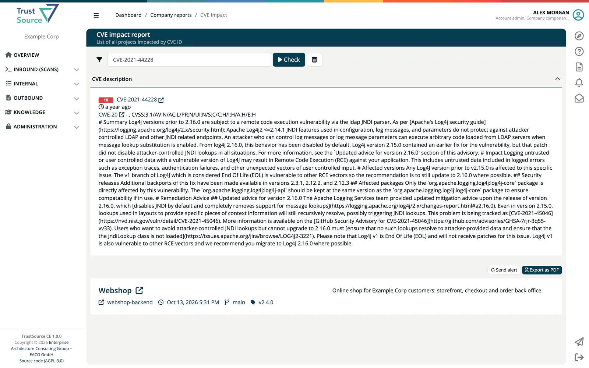

# Recipe: React to a 0-Day Vulnerability

A critical vulnerability has been published. Find out whether your projects and shipped releases are affected, document your assessment and inform your customers.

> [!NOTE]
> **You'll need:** the CVE or GHSA id, analysed modules, and the role **Manager** or **Compliance manager**. For advisories, **Company security manager** or a role that can use **Outbound → CSAF**.
>
> ***TrustSource CE*** takes vulnerability data from OSV for the components it analyses. A new vulnerability becomes visible when an analysis runs after OSV has published it. `TS_OSV_ENABLED` must be on (the default) and the server must reach `api.osv.dev`. See [External services](../01-installation-setup/04-external-services.md).

## Steps

### 1. Refresh the vulnerability data

Run the analyses again so they query OSV:

- per project: open the project and select **Analyze all**;
- per module: the analyse button in the module header;
- from a script: `POST /core/scans/{scan_id}/reprocess` for the latest scan of each module. See [Scans](../09-rest-api/endpoints/scans.md).

> [!TIP]
> Projects with a webhook that has a vulnerability trigger are checked every hour against the vulnerability data the installation holds, and the webhook reports new findings, also for releases. Set this up once under the project's **Webhooks and Channels** settings. The data itself is refreshed only when analyses run, so schedule regular scans or reprocessing as well. See [Webhooks and channels](../03-internal/01-projects/settings/13-webhooks-channels.md).

### 2. Find out where you are affected

Open **Internal → Reports → CVE impact**, enter the id (for example `CVE-2021-44228`) and select **Check**. The report shows the vulnerability with its score and every project and module it affects, with the analysis that contains it and, where set, the responsible project and compliance managers.

Alternatives:

- **Knowledge → Vulnerability Lake → Find vuln** finds the vulnerability and the components it affects.
- **Internal → Reports → Component impact** lists every project that uses a given component, for example when the advisory names a package but no id yet.

A vulnerability that no analysed component matches is not known to the installation, so the CVE impact report finds nothing for it. That is good news only if step 1 ran after the vulnerability was published.

### 3. Check your shipped releases

Open **Internal → Releases** and each release that contains the component. The **New vulnerabilities** tab lists vulnerabilities found after the release was approved.

### 4. Assess each affected module

Decide whether the vulnerability can be exploited in the way the module is used. Set the CVSS environmental values of the module with **Env. settings** in the module header to rescore the vulnerabilities for your environment.

- **Not affected:** open the module's **Settings → Allowed vulnerability** tab and add the vulnerability with your reason. It no longer counts as a violation, and the reason is kept with the module.
- **Affected:** upgrade or replace the component, scan or import again and check the module. For a shipped version, request a new approval; the result is a new release.

Track the work as a risk with tasks under **Internal → Risks** if it takes longer. See [Risks](../03-internal/05-risks/index.md).

### 5. Inform your customers

- Write a CSAF advisory under **Outbound → CSAF → Create**. Publishing it to a CSAF provider needs the `TS_CSAF_PROVIDER_*` settings. See [CSAF](../04-outbound/04-csaf.md).
- Give customers a CSAF feed key so their tools fetch your advisories, or a release key so they fetch the VEX of their release. See [Share an SBOM publicly](08-share-sbom-publicly.md) and [Public routes](../09-rest-api/05-public-routes.md).

## Related

- [Vulnerability Lake](../05-knowledge/04-vulnerability-lake.md)
- [Vulnerability report](../03-internal/04a-vulnerability-report.md)
- [Post-release vulnerabilities](../03-internal/06-approvals/06-post-release-vulnerabilities.md)
- [Background: VEX and CSAF](../../shared/background/11-vex-csaf-vex.md)
