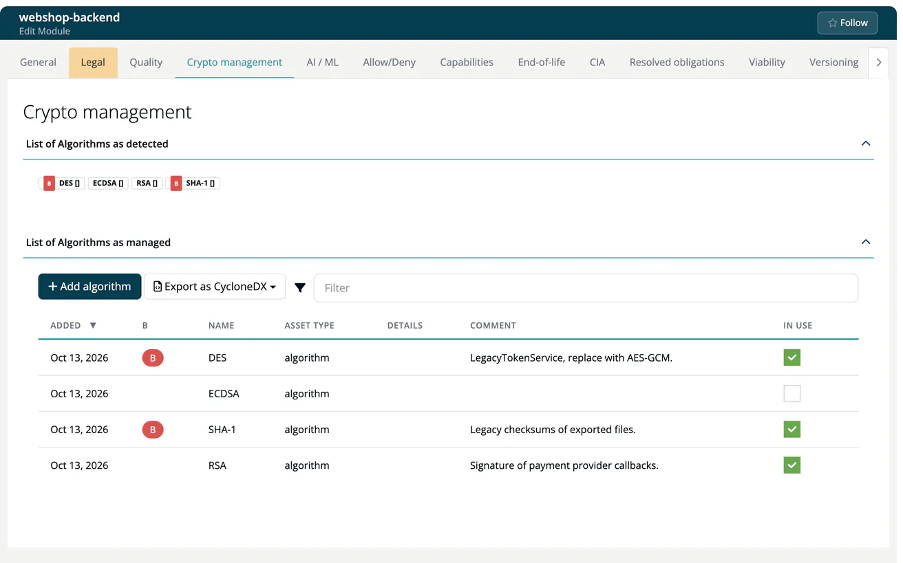

# Recipe: Crypto Inventory for Post-Quantum Readiness

Build an inventory of the cryptographic algorithms your software uses, mark the ones that are not quantum-safe as denied, and find every place they are used.

> [!NOTE]
> **You'll need:**
>
> - A CycloneDX 1.7 CBOM of your software, for example from a cryptography scanner, or the knowledge to enter the algorithms by hand.
> - **Account admin** for the company algorithm list, **Account admin**, **Company security manager** or **Compliance manager** for the crypto policy, and **Manager** or **Compliance manager** (as the module's default owner) or **Developer** to edit a module's crypto settings.
>
> ***TrustSource CE*** has no built-in algorithm catalog and does not detect algorithms in source code. The inventory consists of what you import and what you record. For the background see [Post-quantum security](../../shared/background/07-post-quantum-security.md) and [Crypto agility](../../shared/background/06-crypto-agility.md).

## Steps

### 1. Define your algorithm list

Open **Administration → Settings → Private algorithms**. Add each algorithm you want to track with **Name** and **Strength** and select **Create New**, for example `RSA` / `2048`, `ECDSA` / `256`, `ML-KEM` / `768`. The policy and module settings pick from this list.

### 2. Bring in the crypto data

Import the CBOM into the module, together with or after its SBOM:

- in the app: **Inbound (Scans) → Import Scans**, toggle **CycloneDX**, choose the file and the module name;
- from a pipeline: `POST /core/imports/scan/cyclonedx/json`. See [Imports](../09-rest-api/endpoints/imports.md).

Components of type `cryptographic-asset` become the module's cryptographic assets, linked to the components that use them through the document's `dependencies`. A minimal example:

```json
{
  "bomFormat": "CycloneDX", "specVersion": "1.7", "version": 1,
  "metadata": { "component": { "type": "application", "name": "payment-service", "bom-ref": "app" } },
  "components": [
    { "type": "library", "name": "openssl", "version": "3.0.13",
      "purl": "pkg:generic/openssl@3.0.13", "bom-ref": "openssl" },
    { "type": "cryptographic-asset", "name": "RSA-2048", "bom-ref": "rsa-2048",
      "cryptoProperties": { "assetType": "algorithm",
        "algorithmProperties": { "primitive": "pke", "parameterSetIdentifier": "2048" } } }
  ],
  "dependencies": [
    { "ref": "app", "dependsOn": ["openssl"] },
    { "ref": "openssl", "dependsOn": ["rsa-2048"] }
  ]
}
```

### 3. Review the module's algorithms

Open the module, select **Settings** and the **Crypto management** tab. **List of Algorithms as managed** shows the algorithms found in the imported data and lets you add, correct and remove entries.



The project settings have a **Crypto management** tab as well, for project-wide entries.

### 4. Deny algorithms that are not quantum-safe

The deny list offers only the algorithms of your company's list, so add each algorithm (for example RSA, ECDSA) under **Administration → Settings → Private algorithms** first; see [Private algorithms](../06-administration/02-settings.md#private-algorithms).

Then open **Administration → Policies → Crypto algorithms** and select **Deny algorithm**. Pick the algorithm, optionally a **Strength** (for example `1024` to deny only weak key sizes) and a **Comment**, and select **Add**. Repeat for every algorithm you want to phase out, for example RSA and ECDSA for key exchange and signatures.

### 5. Find where they are used

Under **Internal → Reports**:

- **Algorithm report** - status of all component algorithms per project;
- **All bad crypto** - every use of a denied algorithm (Company security manager, Compliance manager or Portfolio manager);
- **Algorithm impact** - every project that uses a given algorithm.


### 6. Export the CBOM and track progress

Export the inventory as a CycloneDX CBOM: **Outbound → SBOM + CBOM**, open the SBOM file and select **CycloneDX → CBOM (cryptography)**, or call `GET /core/projects/{project_id}/cbom`. Re-import the CBOM after each migration step; **All bad crypto** shrinks as you replace algorithms.

## Related

- [SBOM + CBOM](../04-outbound/01-sbom-cbom.md)
- [Policies](../06-administration/05-policies.md)
- [Crypto management (module)](../03-internal/02-modules/settings/10-encryption.md)
- [Crypto management (project)](../03-internal/01-projects/settings/05-encryption.md)
