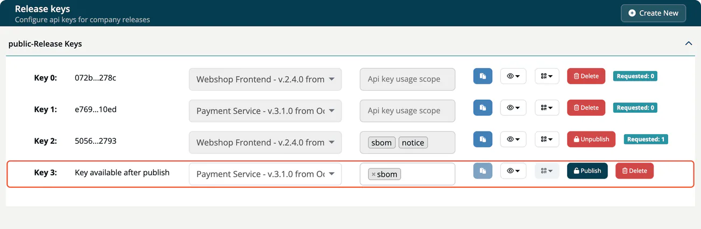
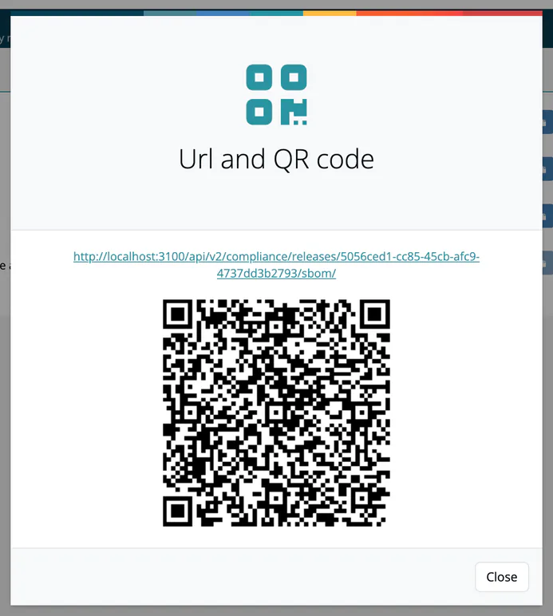

# Recipe: Share an SBOM Publicly

Give a customer, an authority or the public a stable link to the SBOM, notice file and CSAF VEX of a release, without a ***TrustSource CE*** login.

> [!NOTE]
> **You'll need:**
>
> - An approved release (see [Your first module: from scan to signed-off SBOM](01-first-module-to-sbom.md)).
> - The role **Account admin** for the release keys page under **Administration**, or **Manager** or **Compliance manager** to create keys from the release itself.
> - Your installation reachable from where the recipients are, over HTTPS. The links use the address set in `ROOT_URL`. See [HTTPS and reverse proxy](../01-installation-setup/05-https-reverse-proxy.md).

## How it works

A **release key** is a secret in the URL that gives read access to the documents of one release. Anyone who has the link can read what the key serves; nobody else can. You can unpublish the key at any time, and every request is counted.

## Steps

### 1. Create a release key

As **Account admin**, open **Administration → API keys → Release keys** and select **Create New**. **Create New** is available once at least one approved release exists.

As **Manager** or **Compliance manager**, open the release under **Internal → Releases** and select **Published keys → Create new key**. The **Release keys** page under **Administration** is open to the Account admin only.

### 2. Choose the release and the documents

In the new key's row, pick the release (shown as name, version and approval date) and the documents the key may serve:

| Value | Document |
|---|---|
| `sbom` | The release SBOM, signed |
| `notice` | The notice file with licenses, components and copyrights, signed |
| `csaf` | The CSAF VEX of the release, and the VEX of changes since the approval, signed |

Leave the selection empty to serve all three. Use the preview button to check each document before you publish.



### 3. Publish

Select **Publish**. The release and scopes are now fixed for this key. The key can be copied, and the QR code button shows the URL and a QR code for **SBOM**, **Notice** and **CSAF**:

```
https://<your-host>/api/v2/compliance/releases/<release_key>/sbom
https://<your-host>/api/v2/compliance/releases/<release_key>/notice
https://<your-host>/api/v2/compliance/releases/<release_key>/csaf
```



### 4. Share and monitor

Send the URL to the recipient, or print the QR code on the device or its documentation. **Requested** next to the key shows how often it was used.

The documents carry signatures computed with your installation's `TS_ENCRYPTION_KEY`. These are integrity checks (HMAC), not public signatures: only the installation that issued a document can check it. A signed-in user of your installation checks a document under **Outbound → Verify**; recipients without an account cannot verify it themselves. See [Verify](../04-outbound/05-verify.md).

### 5. Withdraw access

Select **Unpublish** (shown when the key has been used) or **Delete** (when it has not). An unpublished key answers `404`; you can publish it again later.

## Did it work?

- [ ] `curl https://<your-host>/api/v2/compliance/releases/<release_key>/sbom` returns JSON with `components` and `signatures`.
- [ ] After a request, **Requested** shows a count of at least 1.

## Variants

- **Share advisories rather than one release:** create a CSAF feed key under **Administration → API keys → CSAF feed keys**. It serves all your CSAF documents of the chosen TLP levels, drafts included, so keep unfinished advisories on a TLP level that no external key holds. See [CSAF feed keys](../06-administration/04c-csaf-feed-keys.md).
- **Share a file:** download the SBOM as CycloneDX, SPDX or PDF from the release's **SBOM** page and send the file.

## Related

- [Release keys](../06-administration/04b-release-keys.md)
- [Public routes](../09-rest-api/05-public-routes.md)
- [Compliance releases](../09-rest-api/endpoints/compliance-releases.md)
