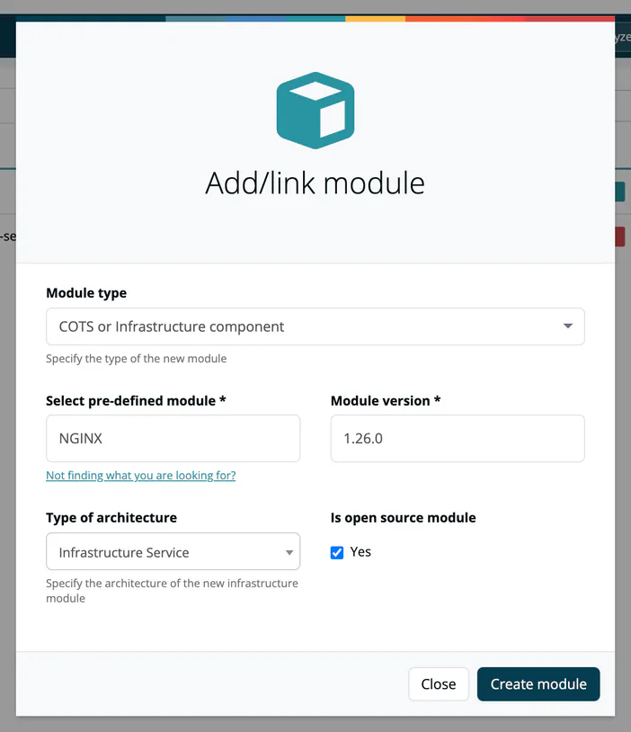

# Recipe: Add an Infrastructure Module

Your software runs on a web server, a database or a message broker that you do not build yourself. Add it to the project as an infrastructure module, so its license and version are part of the project's bill of materials and approvals.

> [!NOTE]
> **You'll need:** a project and the role **Manager** or **Compliance manager**. To add catalog entries: **Company component manager**.
>
> A fresh installation's infrastructure catalog already contains NGINX, Apache HTTP Server, MariaDB, MongoDB, RabbitMQ and Apache Kafka with a few versions each. More entries are added under **Knowledge → Infrastructure Elements**.
>
> Infrastructure modules carry the license data of their catalog entry. TrustSource CE does not look up vulnerabilities for catalog components, so these modules show no vulnerability findings. Track known vulnerabilities of your infrastructure by other means.

## Steps

### 1. Open the dialog

Open the project and select **Add/link**. In **Add/link module** set **Module type** to **COTS or Infrastructure component**.

### 2. Pick the component and version

Start typing in **Select pre-defined module**, for example `NGINX`, and pick the entry. Then pick the **Module version**, for example `1.26.0`.

Set **Type of architecture**, for example **Infrastructure Service** for a web server or **System component** for an operating system package. Tick **Is open source module** if the component is open source.

### 3. Create the module

Select **Create module**. The module appears in the project; in the grid view and on the module page it is labelled **Infrastructure Module** and carries the license of the catalog entry.

### 4. If the component is not in the catalog

Select **Not finding what you are looking for?**, enter **Module name** and **Module version** and select **Send request**. The module is created with these values but without catalog data. Ask a Company component manager to add the component under **Knowledge → Infrastructure Elements** with its versions and licenses. See [Infrastructure Elements](../05-knowledge/02-infrastructure-elements.md#maintain-the-catalog).

### 5. Keep it current

When you upgrade the component in production, update the module's version in its **Settings** and run the analysis again with **Analyse**, so the next approval reflects what you run.

## Did it work?

- [ ] The project lists the module with the **Infrastructure Module** label and the version you picked.
- [ ] The module's view shows the license of the catalog entry.
- [ ] The next approval of the project can include the module.

## Variants

- **Commercial software (COTS):** the same dialog finds entries of **Knowledge → 3rd party (COTS)**; they are labelled **COTS Module**.
- **Another project's release:** choose **Link company project** to add an approved release of another project as a module.

## Related

- [Infrastructure modules](../03-internal/02-modules/03-infrastructure-modules.md)
- [Infrastructure Elements](../05-knowledge/02-infrastructure-elements.md)
- [3rd party (COTS)](../05-knowledge/03-cots.md)
