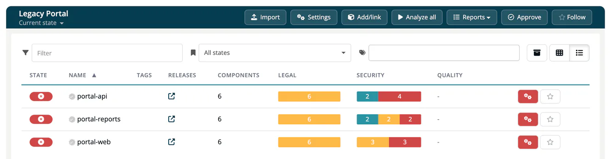

# Recipe: Migrate from Another SCA Tool

Bring the bills of materials you keep in another software composition analysis tool into ***TrustSource CE***, then continue with scans from your pipelines.

> [!NOTE]
> **You'll need:**
>
> - SBOM exports from the old tool: CycloneDX 1.2 to 1.7 JSON, SPDX JSON or SPDX RDF. SPDX tag-value and spreadsheets are not supported; convert them to SPDX JSON first.
> - The role **Manager** or **Compliance manager** to create projects in the app, or an API key with the scope `developer` or `manager` for scripted imports. Both scopes can also create projects with `POST /core/projects`.

## Steps

### 1. Plan the structure

Map the old tool's structure to projects and modules: a **project** groups the parts of one product or service, a **module** is one buildable part with its own bill of materials. One SBOM file becomes one module. Choose module names you will keep: later scans and SARIF uploads must use the same names to land on the same module.

### 2. Export the SBOMs

Export one CycloneDX or SPDX file per application, component or repository from the old tool.

### 3. Create the projects

Create each project under **Internal → Projects → Create**, or with the API, which returns the existing project if the name is taken:

```bash
curl -X POST "https://<your-host>/api/v2/core/projects" \
  -H "x-api-key: $TS_API_KEY" -H "Content-Type: application/json" \
  -d '{"name": "Legacy Portal"}'
```

### 4. Import the files

**A few files:** open **Inbound (Scans) → Import Scans**, pick the project, set the toggle to **CycloneDX** or **SPDX**, choose the **File**, enter the **Module name** and select **Import**.

**Many files:** loop over them with the import API. This example imports every CycloneDX file of a folder into one project, named after the file:

```bash
for f in sboms/*.json; do
  module=$(basename "$f" .json)
  curl -fsS -X POST \
    "https://<your-host>/api/v2/core/imports/scan/cyclonedx/json?project=Legacy%20Portal&module=$module" \
    -H "x-api-key: $TS_API_KEY" -F "file=@$f"
  echo
done
```

For SPDX use `.../imports/scan/spdx/json` or `.../imports/scan/spdx/rdf`; for RDF set the content type on the file part, `-F "file=@$f;type=application/rdf+xml"`, or the upload is read as JSON and refused with `400`. Each import answers with `scanId` and `moduleId`; `warning` and `contentNotices` name values that could not be taken over, for example licenses that did not match a known license. See [Imports](../09-rest-api/endpoints/imports.md).



### 5. Set the legal settings

Run the legal settings wizard for each project and, where the distribution differs, for each module. Without legal settings the license evaluation is not meaningful. See [Fill in the Legal Questionnaire](12-legal-questionnaire.md).

### 6. Carry over your decisions

Decisions you made in the old tool are not part of an SBOM. Record them again:

- licenses and components you always allow or deny: company-wide under **Administration → Settings → License allow/deny** and **Administration → Settings → Component allow/deny**, or per project and module on their **Allow/Deny** settings tabs;
- vulnerabilities you assessed as not exploitable: on the module's **Allowed vulnerability** settings tab, with your reason;
- licenses you determined by hand: with [manual license resolution](../03-internal/02-modules/06-manual-license-resolution.md).

### 7. Review and switch over

Check each module's **List** and **Legal** tabs and the project reports. Then point your pipelines to ***TrustSource CE*** with the same project and module names. See [CI/CD Integration](02-cicd-integration.md).

## Did it work?

- [ ] Every exported SBOM is a module in the intended project.
- [ ] The modules show components and an analysis date.
- [ ] A new pipeline run updates an existing module instead of creating a second one.

## Related

- [Import Scans](../02-inbound/02-import-scans.md)
- [Module import (project settings)](../03-internal/01-projects/settings/11-module-import.md)
- [Background: SBOM formats](../../shared/background/10-sbom-formats.md)
