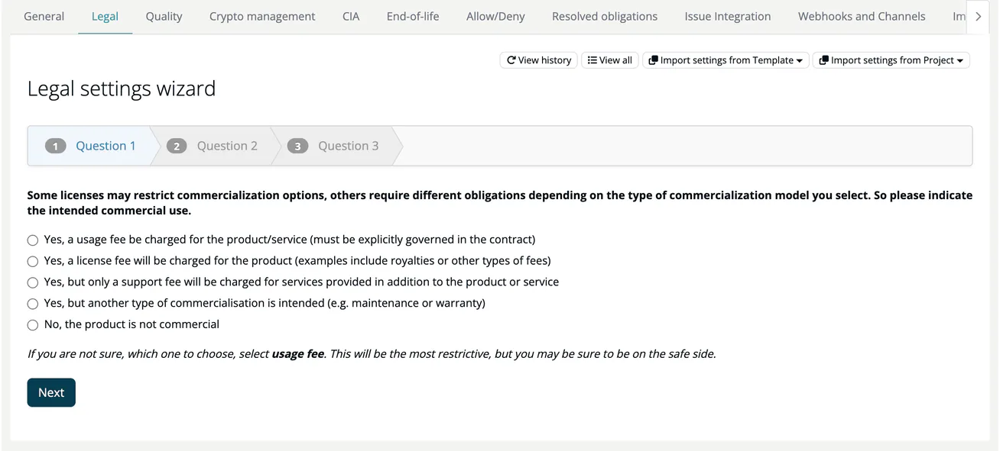

# Recipe: Fill in the Legal Questionnaire

The legal settings tell ***TrustSource CE*** how you use and distribute your software. They decide which license obligations apply and which licenses count as violations. The **Legal settings wizard** asks for them one question at a time.

> [!NOTE]
> **Time:** a few minutes per project, and a few minutes per module whose distribution differs.
>
> **You'll need:** the role **Manager** or **Compliance manager**, as default project or compliance manager of the project or module, or on a project or module without such an owner.

The questionnaire has two parts:

- **Project level** - commercial use, operating model and IP protection. Fill it once per project.
- **Module level** - trade secrets, sub-licensing and distribution. Fill it per module.

## Part 1 - the project

1. Open the project, select **Settings** and the **Legal** tab.
2. Select **Start wizard**. The **Legal settings wizard** asks three questions; move with **Next** and **Back**:

   | Step | Setting | Answers |
   |---|---|---|
   | **Question 1** | Commercial Aspects | Usage fee, license fee, only a support fee, another type of commercialisation, or not commercial |
   | **Question 2** | Operating Model | Software as a Service, managed service at the customer's location, traditional software distribution, or part of an appliance or device |
   | **Question 3** | Inbound IP Protection and Outbound IP Protection | Whether to flag licenses without explicit contributor patent grants, and licenses that end when you enforce your own patents |

3. Select **Finish**. The app confirms **Legal settings changed!**.

If you are unsure, the app recommends the most restrictive answers: **usage fee** for the commercial aspects and the embedded (appliance) model for the operating model.

**View all** shows the same settings as one form; **View history** lists earlier values. **Propagate settings to...** copies the settings to other projects, and **Import settings from Project** or **Import settings from Template** takes them from another project or from a legal template.

## Part 2 - the modules

1. Open the module, select **Settings** and the **Legal** tab. The project's answers are shown at the top.
2. Select **Start wizard** and answer:

   | Step | Setting | Answers |
   |---|---|---|
   | **Question 1** | Trade Secret Protection | Trade secrets need to be protected, or may be released |
   | **Question 2** | Sub-licensing alert | The module is licensed under a proprietary license, or released as open source |
   | **Question 3** | Distribution | On-premise installer or download; integral part of a shipped appliance, device or software; exchangeable add-on; client-side library in a web solution; server-side library not distributed; or not distributed at all |

3. Select **Finish**.

**Propagate settings to...** copies the module's answers to other modules, for example **All my project modules**. **Import settings from Module** and **Import settings from Template** work as on the project.

## What happens next

On the next analysis, the licenses of the module's components are evaluated against these settings by the bundled ts-legalcheck service. The results appear on the module's **Legal** tab as obligations and violations, and in the [license check](../09-rest-api/endpoints/compliance-check.md), which refuses to check a project or module whose legal settings are incomplete. Record how you meet obligations on the **Resolved obligations** settings tab.

> [!TIP]
> If many projects share the same answers, create a legal template once under **Administration → Settings → Legal templates** and import it into each project. See [Legal templates](../06-administration/02-settings.md#legal-templates).

## Related

- [Legal settings (project)](../03-internal/01-projects/settings/02-legal.md)
- [Legal settings (module)](../03-internal/02-modules/settings/02-legal.md)
- [Resolved obligations](../03-internal/01-projects/settings/08-obligations.md)
- [Handle a license conflict](03-handle-license-conflict.md)
