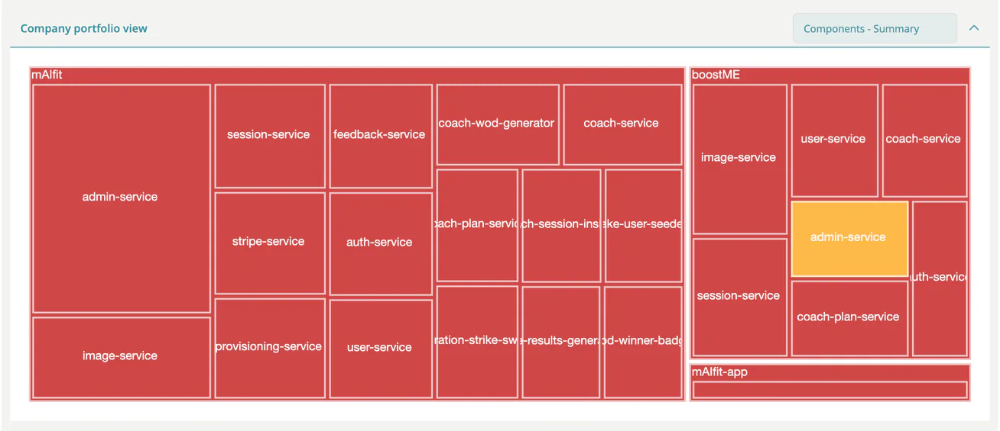

# The Dashboard

The dashboard is the first page after login. It gives you your portfolio status, your pinned projects and pending work at a glance. Which widgets you see depends on your role, and the dashboard only fills with data once your company has at least one module in ***TrustSource***.

## Welcome banner

The banner at the top has these buttons:

- **Take tour** starts a guided tour of the navigation, content area, settings, messages and help. It starts by itself on your first visit.
- **Load demo project** creates a demo project with sample modules, so you can try the widgets. It shows while your company has no modules, and also as long as you have never loaded the demo, even when modules exist.
- **Remove demo data** deletes the demo project again. It replaces the load button while demo data exists.

## Widgets by role

| Widget | Shown to |
|---|---|
| Company portfolio view | `portfolio_manager` |
| Focussed projects | `developer`, `compliance_manager`, `manager`, `account_admin` |
| Incoming approval requests | `compliance_manager` |
| Current modules compliance | `developer`, `compliance_manager`, `manager`, `account_admin` |
| Our latest videos | `developer`, `compliance_manager`, `manager`, `account_admin` (everyone with an empty portfolio) |
| Δ since last … / History for last 12 … | `developer`, `compliance_manager`, `manager`, `account_admin` |
| Licenses inside component versions, Modules overview | `developer`, `compliance_manager`, `manager`, `account_admin` |
| Activity log | `compliance_manager`, `manager` |

Other roles see *No widgets are available for your role*. No widget requires a license feature.

> [!NOTE]
> Without any module, the dashboard shows only the video panel and, for `compliance_manager` and `manager`, the activity log.

## Company portfolio view

A treemap of all your projects (large rectangles) and their modules (small rectangles). Colours show the worst status: red for violations, yellow for warnings, teal otherwise. The panel is collapsed while your company has fewer than two modules.

1. Choose a **View type**. The first word sets the size of the rectangles (components or licenses), the second the status that colours them: **Components - Summary**, **Licenses - Summary**, **Components - Vulnerability**, **Components - Legal**, **Components - Viability**, **Components - Versioning**.
2. Click a project to zoom into it. Click **Back to all** to return.
3. Click a module to open its dependencies in a new tab.

## Focussed projects

Shows your pinned projects as cards, with a count badge. Pin a project with the thumbtack button (**Pin to Dashboard**) in the project list. Unpin it with the same button (**Unpin from Dashboard**). Without pins it reads *You have not pinned any project yet* and stays collapsed.

## Incoming approval requests

Open approval requests grouped by project and module, with a count badge. Each line shows the release name, creator, age and links to the Notice or SOUP file. Click the release name to open the [approval](../03-internal/06-approvals/index.md). Click **assign to me** to take the request, or the cross to remove your assignment. The panel reads *No incoming approval requests were found* when nothing is pending.

## Current modules compliance

Three bars for **Modules**, **Unique components** and **Licenses**. Each bar splits into violations (red), warnings (yellow) and OK (green); hover a segment for the count.

## Δ since last … and History

- **Δ since last day/week/month** shows the change in modules, components and licenses since the previous snapshot.
- **History for last 12 days/weeks/months** shows the same three numbers as small bar charts over the last 12 periods.

The period depends on the age of your company data: days for the first two weeks, weeks until about 12 weeks, months after that.

## Licenses inside component versions and Modules overview

- **Licenses inside component versions** is a pie chart of the licenses in use. Choose a project or **All projects** in the selector.
- **Modules overview** is a bar chart per module. Click a bar to open the module's licenses.

## Activity log

The ten latest company log entries with user, age and message. Failed actions show a red mark. **View all logs** opens the [company logs](../06-administration/07-audit-logs.md).

## Our latest videos

Recent TrustSource videos. Click one to play it.

## Related

- [A 5-Minute Tour](04-quick-tour.md)
- [Roles & Licenses Cheat Sheet](06-roles-licenses-cheatsheet.md)
- [Reports](../03-internal/04-reports.md)
