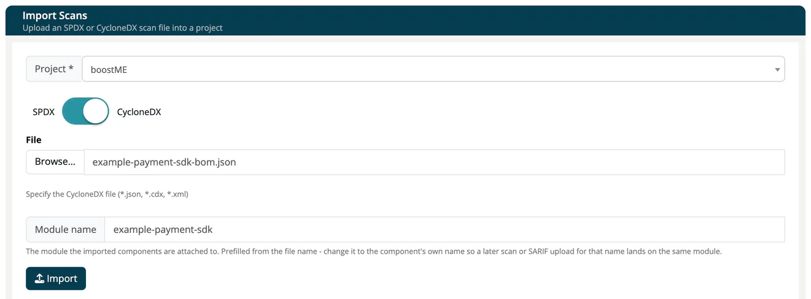

# Import Scans

> [!NOTE]
> **Required role:** `developer`, `compliance_manager`, `manager` or `account_admin`

**Import Scans** lets you upload an existing SBOM into ***TrustSource*** without a build pipeline. Use it for an SBOM from a supplier, a file from a local scanner, or data from another tool. The import creates a scan on a module, exactly as a [CI/CD scan](03-cicd-scan.md) would.

## Import a file

1. Open **Inbound → Import Scans**.
2. Pick the **Project**. Choose **+ Create new project** to have one created for you (named *New project*, with a number added if the name is taken).
3. Set the switch to **SPDX** or **CycloneDX**.
4. Press **Browse...** and select the file.
5. Check the **Module name**. It is prefilled from the file name; change it to the component's own name, for example `nordwind-mobile-app`.
6. Press **Import**.

***TrustSource*** shows a note that the import status can be checked on the project's **Imports** page (open it from the project's **Reports** dropdown) and takes you to the project's modules. See [Imports (Project)](../03-internal/01-projects/settings/11-module-import.md).

## Supported files

| Format | File types | Notes |
|---|---|---|
| **CycloneDX** | `.json`, `.cdx` | CycloneDX 1.2 to 1.7 and the 2.0 draft. Exports stay on CycloneDX 1.7. |
| **SPDX** | `.json`, `.spdx`, `.rdf`, `.xml` | SPDX JSON and SPDX RDF/XML, told apart by content, not by file name. SPDX tag-value is not supported, even with the `.spdx` extension. |

The file picker also accepts `.xml` with **CycloneDX** selected, but CycloneDX XML cannot be imported: the project's **Imports** page lists the import with the error *400 import file has invalid schema*. Convert the file to CycloneDX JSON first.

> [!CAUTION]
> A CycloneDX document written in the 2.x form (`specFormat`) with a `specVersion` other than 2.x is rejected. Through the API the answer is `400` naming the version, for example `Unsupported CycloneDX specVersion: 3.0`.

Files up to 10 MB can be imported in the web interface. Through the API a file may be up to 50 MB by default; a larger file is refused with `413`.

### What the import reads

- **SPDX** documents keep their dependency structure: the relationships that say what depends on or contains what are read, and a package mentioned in no relationship is still imported. Licenses are recorded with their identifier, and the license the document declared is kept.
- **CycloneDX** components of the type *cryptographic asset* and *machine learning model* are attached to the components they belong to rather than shown as dependencies.
- Dependency chains deeper than 40 levels continue as further top-level entries, so nothing is dropped.

## Module names

The module name decides where the data lands. ***TrustSource*** trims leading and trailing spaces, then matches the name exactly (no case folding) inside the project. If the module exists, the import adds a scan to it; otherwise it creates the module. A later scan or SARIF upload with the **same** name lands on the same module; see [SW Quality Scans](04-sw-quality-scans.md).

Project names are matched the same way, trimmed: `"  Storefront  "` resolves to `Storefront`. If your company has two projects with the same name, uploads addressed by name go to the oldest one.

## Skipped dependencies

One unusable dependency no longer stops a scan. An entry without a usable identifier, or one that cannot be processed, is skipped; the rest of the file is imported. The scan records how many entries were skipped and lists the first 100 with their reason and position, and **Company Logs** shows one entry per scan, for example *"12 dependencies skipped"*.

## Other ways in

- **Threat models.** A CycloneDX threat-model BOM (TM-BOM, 2.0 draft) is imported on the Threat Models page, not here. See [Create a Threat Model](../03-internal/08-threat-models/01-create-threat-model.md).
- **Operational BOMs (OBOM).** An OBOM is uploaded by `ts-scan` or through the API and appears on the module's **OBOM** tab; it needs the `obom` license. See [OBOM endpoints](../09-rest-api/endpoints/obom.md).
- **API.** Send the same files to the [import endpoints](../09-rest-api/endpoints/imports.md).

> [!TIP]
> If you import regularly, set up a [CI/CD integration](03-cicd-scan.md) so every build delivers its own scan.

## Related

- [CI/CD Scan](03-cicd-scan.md)
- [Mental Model](../00-getting-started/05-mental-model.md)
