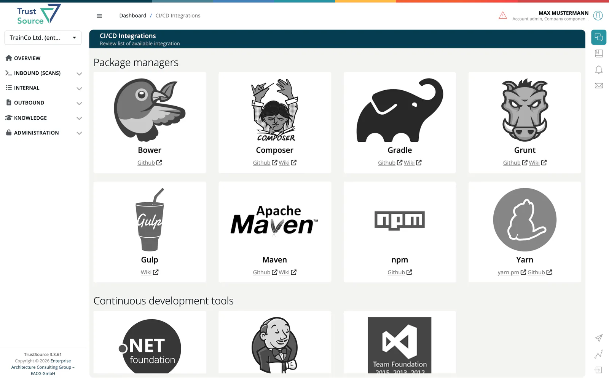
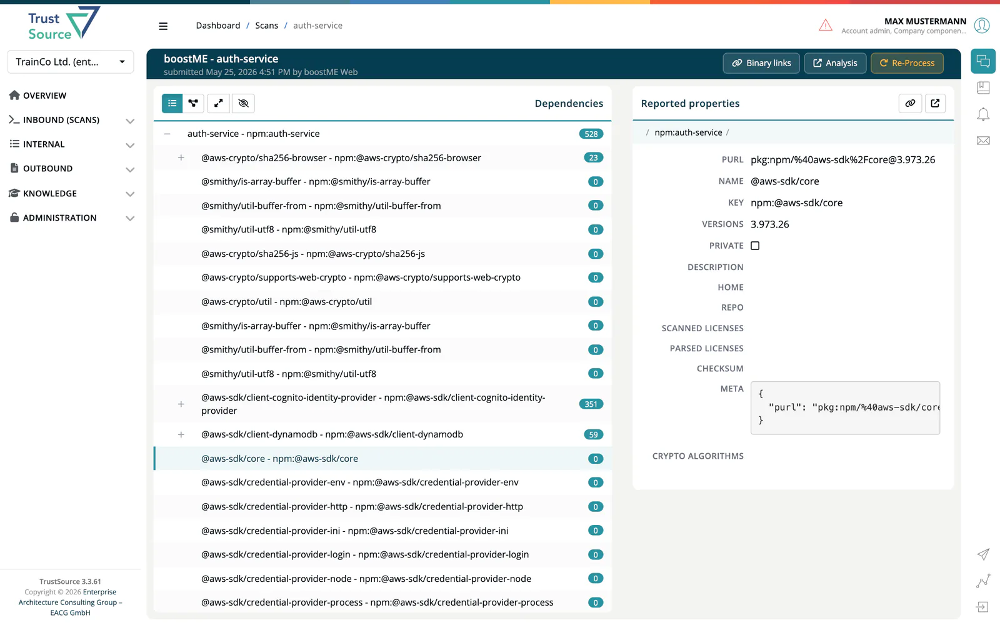

# CI/CD Scan

> [!NOTE]
> **Required role:** `developer`, `compliance_manager`, `manager` or `account_admin`

A **scan** is a snapshot of a module's bill of materials at one point in time: every component with its versions, licenses and dependencies. Scans from your build pipeline are the main way data enters ***TrustSource***. Open the list from **Inbound → CI/CD Scan**.

## How scans arrive

| Source | How |
|---|---|
| **CI/CD scanner** | A scanner in your build pushes the result through the REST API after each build, using your API key. |
| **REST API** | Post scan data to the [scans endpoint](../09-rest-api/endpoints/scans.md). |
| **SBOM import** | An uploaded SPDX or CycloneDX file creates a scan too; see [Import Scans](02-import-scans.md). |

Each scan belongs to exactly one module. The project must exist already; if the module named in the upload does not exist yet, it is created. Names are trimmed and matched exactly, so a [SARIF upload](04-sw-quality-scans.md) with the same module name lands on the same module.

> [!WARNING]
> A mismatch in the module name, for example a package manifest name against a checkout folder name, silently creates a second module instead of adding to the first. See [SW Quality Scans](04-sw-quality-scans.md#import-with-the-api).

### Limits and rejections

- A dependency tree nested more than 80 levels is refused with `400`; the message names the limit and the component. The same limit covers deeply nested content elsewhere in the upload.
- Files above the upload limit (50 MB by default) are refused with `413`; a request without an API key is refused with `401`.
- A request without a `User-Agent` header is refused with `400` (*mandatory User-Agent header missing*). An unknown or outdated scanner name in the header is accepted; the response then carries a note in `info`.
- A project that does not exist in your company is refused with `404` (*Resource not found*). Create the project first; only the module is created on the fly.
- One unusable dependency does not stop the scan: it is skipped and recorded. The scan keeps the count and the first 100 entries, and **Company Logs** shows how many were skipped.
- A checksum that fails validation is not stored; the response carries a warning.

## Scanners and plugins

The **CI/CD Integrations** catalogue lists the available scanners with links to their repositories and guides. It is open at `/scanners` and has no menu entry.

| Group | Entries |
|---|---|
| **Package managers** | Bower, Composer, Gradle, Grunt, Gulp, Maven, npm, Yarn |
| **Continuous development tools** | .Net foundation, Jenkins, TFS |
| **Containers** | Docker scanner |
| **Development languages** | Java, JavaScript, NodeJS, C/C++, PHP, Python, Ruby |
| **IDE Plugins** | VisualStudio |

## The scan list

The list shows the transferred scans of your company, newest first. Queries are limited to 200 items.

| Column | Meaning |
|---|---|
| **When** | Time the scan was received. |
| **Project - Module** | Where the scan belongs. |
| **Upload by** | The user who uploaded the scan. |
| **Dependencies** | Number of dependencies found. |
| **Meta** | Branch, tag and binary links of the scan. |

Select a row to open the scan.

## Scan details

The header shows project, module, branch, tag and the number of binary links, and who submitted the scan when. Buttons:

- **Binary links**: manage the links to the built artifacts.
- **Analysis**: open the module analysis for this scan; shown as *Analysis N/A* if none exists.
- **Notices**: appears when validation found unknown licenses; check that they do not affect your company.
- **Re-Process**: for `manager` and `compliance_manager`: runs processing and analysis of the scan again, for example after policies changed.

The body shows the dependency tree. Switch between **List** and **Diagram**, **Expand** or **Collapse** all levels, and **Show linked** or **Hide linked** modules. Selecting a dependency opens **Reported properties** at its side: purl, name, key, versions, whether it is private, description, homepage, repository, scanned and parsed licenses, checksum, meta data and crypto algorithms. For the module's own component (the root of the tree), a `compliance_manager` or `manager` of an account with private licenses can **Select license**; the selection is saved per module and re-applied on the next analysis run. **Lake** opens the component in the [Component Lake](../05-knowledge/01-component-lake.md).

## Related

- [Import Scans](02-import-scans.md)
- [REST API → Scans](../09-rest-api/endpoints/scans.md)
- [Module Detail](../03-internal/02-modules/02-module-detail-tabs.md)
