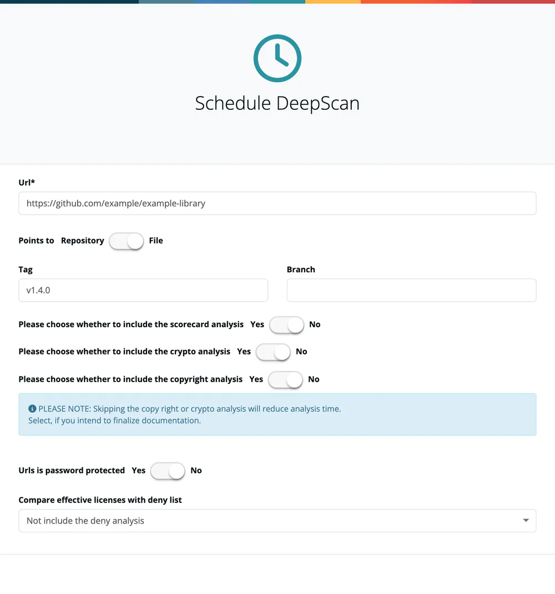

# Repository Scans

> [!NOTE]
> **Required role:** `account_admin`, `company_component_manager`, `compliance_manager` or `manager` (the menu entry is shown to these roles only).

A repository scan (DeepScan) analyses a Git repository or a file at source level. It finds licenses and copyright notices in individual files and can add a crypto inventory and an OpenSSF Scorecard. It catches what package managers do not report: vendored code, copied snippets and non-standard license headers. The page is titled **Repositories [DeepScan]** and opens from **Inbound → Repository Scans**.

## Schedule a scan

1. Press **Schedule DeepScan**.
2. Enter the **Url**. The switch **Points to** (**Repository** or **File**) says whether it points to a Git repository or to a single file.
3. Optionally enter a **Tag** or **Branch**.
4. Choose per option **Yes** or **No**: **Scorecard**, **Crypto** and **Copyright** analysis.
5. For a private repository, set **Urls is password protected** to **Yes** and enter the **Username** and the **Password / PersonalAccessToken(PAT)**.
6. Optionally select a deny list under **Compare effective licenses with deny list**.
7. Press **Schedule DeepScan**.

## The scan list

The three buttons **Repositories**, **Files** and **Local** filter the list by scan type. Icons mark the options a scan was run with (copyright, crypto, scorecard) and whether it is linked. Columns: **Url**, **Created**, **Last execution** and **Last result**. Row actions:

- **Re-scan** (play button) runs the scan again; for a private repository the dialog lets you enter credentials again.
- **Link** connects the scan to a module, a dependency inside a module, or an infrastructure component or COTS.
- **Remove** deletes the scan.

Select a row to open the result.

## Read a result

The header shows the repository (with tag or branch) and a list of earlier runs: **Scan from ...** switches between executions. Next to it:

- **Scorecard**: the OpenSSF Scorecard score out of 10 with every check, its reason and details. It reports plainly if the Scorecard failed, is still running or is missing. The Scorecard icon in the list opens the scan with the Scorecard open.
- **Identify known** / **Show all**: hide or show files that are known.
- **Always deny**: choose the deny list to compare against.
- **Stats**: incompatible license combinations, blacklisted licenses, license types, copyleft licenses and, if you switched it off, a note that copyright analysis was off.

The file tree can be filtered by name, by license and by status, and expanded or collapsed. A file's side panel shows licenses, copyrights, crypto algorithms (a red **B** marks a denied one) and a link to the file in the repository.

### Correct a finding

Select a license manually or enter a copyright manually to overwrite what the service found, add a comment, then use **Approve file result** or **Reject file result**. Feedback is kept for the file.

## Scorecards for components

A component's **Scorecard** action requests only a Scorecard, not a full DeepScan, and mails the result to you. The **OpenSSF Scorecard** report can request a Scorecard for every component without one, listing components without a repository; repositories requested in the last 7 days are skipped. See [Reports](../03-internal/04-reports.md).

## Related

- [Mass Scans](06-mass-scans.md) - scan every component of a module in one pass
- [Algorithms](../05-knowledge/05-algorithms.md)
- [Licenses](../05-knowledge/06-licenses.md)
