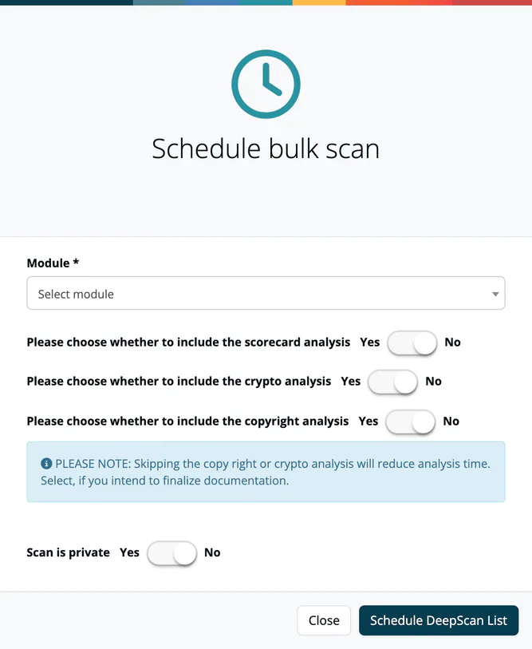

# Mass Scans

> [!NOTE]
> **Required role:** `compliance_manager`, `manager` or `account_admin`
> **Required account type:** Enterprise
> **Status:** Beta

A mass scan runs a [repository scan](05-repository-scans.md) for every component of a module in one pass. Use it to get file-level license and copyright evidence for a whole bill of materials, for example before a release or after a policy change. The page is called **Bulk repository** and opens from **Inbound → Mass Scans** (marked *B* for beta); the menu entry is not shown for other account types.

## Schedule a mass scan

1. Press **Schedule scan**.
2. In **Schedule bulk scan**, choose the **Module**, grouped by project.
3. Choose the **Analysis/Version** of the module to scan.
4. Choose **Yes** or **No** for the options, as for a single repository scan, and for **Scan is private**.
5. Press **Schedule DeepScan List**.

***TrustSource*** takes every component version of that analysis whose repository it knows and schedules one scan for each. A mass scan covers at most **500 component versions**; for a larger module the request is refused with a message saying so.

## Monitor and review

The list shows the private flag, the options (copyright, crypto, scorecard), the **Name** (project and module) and **Created**. A key button toggles private and public; the trash button removes the mass scan. Select a row to open it.

The detail page lists, per component version: **Url**, **Key**, **Version**, **Executed**, **Completed**, **Declared licenses**, **Found licenses**, **Found copyrights**, a link to the **Results** and the **Status**. The header offers:

- **Statistics**: completed, running or rejected, and failed scans, and how many scans found the same license, no result or another license than declared;
- **CSV** to export the table and **Copy** to copy it;
- a state filter for the rows.

Select a result to open the single scan with the file tree.

> [!CAUTION]
> Removing a mass scan removes its results.

## Related

- [Repository Scans](05-repository-scans.md)
- [Licenses](../05-knowledge/06-licenses.md)
