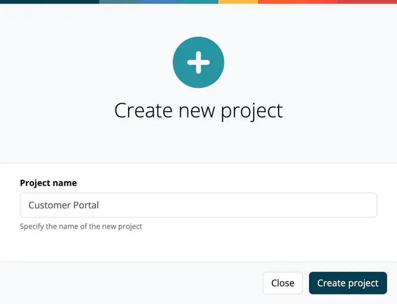
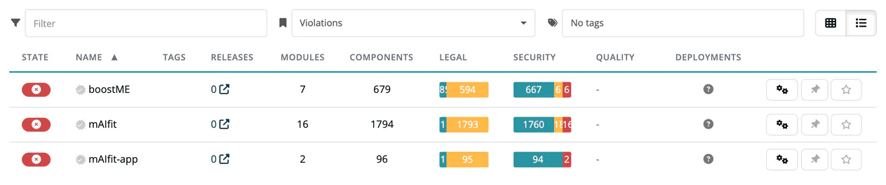

# Create & List Projects

> [!NOTE]
> **Required role:** `manager` or `compliance_manager` to create a project. `developer`, `compliance_manager`, `manager` and `account_admin` see **Projects** in the sidebar.

## Creating a project

1. Navigate to **Internal → Projects**.
2. Click **Create**.
3. In the **Create new project** dialog, enter the **Project name** (3 to 200 characters, unique within your company). Leading and trailing spaces are removed.
4. Click **Create project**.

A toast confirms *Project successfully created!*. A name that is already taken is refused with the message that a project with the same name already exists. The new project has default settings. If you are a manager, you become its default project manager; if you are a compliance manager, its default compliance manager. A role you do not hold is filled with another user of the company who holds it. The member list starts empty. Configure everything else (application goals, tags, managers, legal settings) in the [Project Settings](settings/index.md) afterwards.

If your plan's project limit is reached, a **Limit was reached** note above the list asks you to upgrade or to reduce the number of projects.

> [!TIP]
> Give projects clear, descriptive names that match your team's vocabulary, for example "Customer Portal", "Firmware v3" or "Mobile App iOS".

## Demo project

Managers and compliance managers see more buttons in the header: **Generate** adds a demo project with a sample module, and **Remove demo** (shown while a demo project exists) removes all demo projects and modules again.

## The project list

The project list supports two views: **Grid** (cards) and **Table** (columns). In grid view, the sort button toggles the order by name; in table view, click a column header to sort.

### Table columns

| Column | What it shows |
|---|---|
| **State** | Traffic light: OK, Warnings or Violations. |
| **Name** | Project name with approval badge. |
| **Tags** | Tags assigned to the project. |
| **Releases** | Number of releases; the link opens the releases list filtered to the project. |
| **Modules** | Number of modules in this project. |
| **Components** | Total component count across all modules. |
| **Legal** | Legal status bar: OK, warnings and violations. |
| **Security** | Vulnerability status bar, same breakdown. |
| **Quality** | Status bar of the SARIF test results (only when your plan includes `sarif`). |
| **Deployments** | Number of deployments with an OBOM (only when your plan includes `obom`). |

The last column holds **Settings**, pin and follow.

### Filtering and sorting

- **Filter**: filter by project name as you type.
- **All states / OK / Warnings / Violations**: filter by traffic-light state.
- **Tags**: select one or more company tags. Without company tags, the field reads **No tags** and links to the company tags.

If modules exist that belong to no project, the list also shows **Unassigned Modules**. Click any project to open the [Project Overview](02-project-overview.md).

## Related

- [Project Overview](02-project-overview.md): what you see after clicking a project
- [Project Settings](settings/index.md): configure the project after creation
