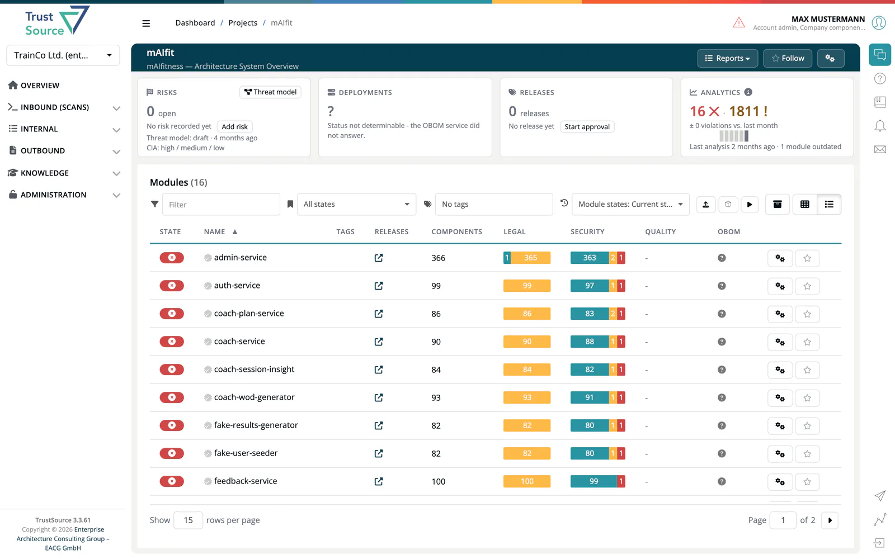

# Project Overview

> [!NOTE]
> **Required role:** `developer`, `compliance_manager`, `manager` or `account_admin`. **Import**, **Add/link**, **Analyze all**, **Start approval**, **Add risk** and threat model generation are for `manager` and `compliance_manager`.

The project overview is the landing page when you click a project. It shows the project header, a row of tiles and the list of the project's modules with their compliance status.

## What you see

- **Header:** project name with approval status (and the LeanIX icon if linked), the start of the application goals and the tags, plus the actions listed below. If the project has modules you are not allowed to see, a red note such as *3 of 5 visible to you* appears.
- **Tiles:** a row of up to four tiles, each with a headline number and a click-through to its own page:
    - [**Risks**](05-risks-and-releases.md) (needs the `risks` license): open risks, the threat model status (with the `threat` license) and the project's CIA rating.
    - [**Deployments**](03-deployments.md) (needs the `obom` license and read access to the project's OBOM): deployments and the age of their newest OBOM.
    - [**Releases**](05-risks-and-releases.md): approved releases and pending approvals.
    - [**Analytics**](04-analytics.md): violations and warnings with the change against last month.

    A tile that cannot be loaded shows `?` and the reason, for example *Status not determinable - the OBOM service did not answer.*
- **Module list:** the project's modules as **cards** (grid) or **rows** (table), each with approval status badge, status ribbon (OK, Warnings, Violations), compliance bars and last analysis date. The list toolbar has the **Filter** box, the state filter (**All states**, **OK**, **Warnings**, **Violations**), the **Tags** filter, the **Module states** selector, **Import**, **Add/link** and **Analyze all**, **Show archived** / **Hide archived** and the **Grid** / **Table** switch. On a narrow screen these actions move into a **More actions** menu. The grid or table choice is remembered separately for the project list and the module list.

**Module states** switches the module list to the analyses approved with an earlier version of the project (**Current state** shows the modules as they are now). A note above the list then shows which approval you are looking at, with **Back to current state**. The tiles always show the current state.

## Header actions

| Action | What it does |
|---|---|
| **Reports** | Dropdown with the project-scoped reports, each opening in a new tab: Licenses, Viability, OpenSSF, Versioning, Algorithms, Vulnerability, Obligations, Credits and Modifications. Below the divider: [**Resolved obligations**](settings/08-obligations.md) and [**Imports**](settings/11-module-import.md) (import history), shown only if you have access. |
| **Follow** | Follow the project to get notifications. |
| **Settings** (cogs icon) | Open [Project Settings](settings/index.md). |

> [!NOTE]
> To approve the project, use **Start approval** on the **Releases** tile. It opens the project approval wizard (Settings, Pick modules, Select analysis, Confirm statuses, Finalization). A single module can also be approved from its own page with **Initiate approval**. See [Approvals](../06-approvals/index.md).

Click any module to open the [Module Detail](../02-modules/02-module-detail-tabs.md).

## Related

- [Project Settings](settings/index.md): configuring this project
- [Module Detail Tabs](../02-modules/02-module-detail-tabs.md): what you see inside a module
