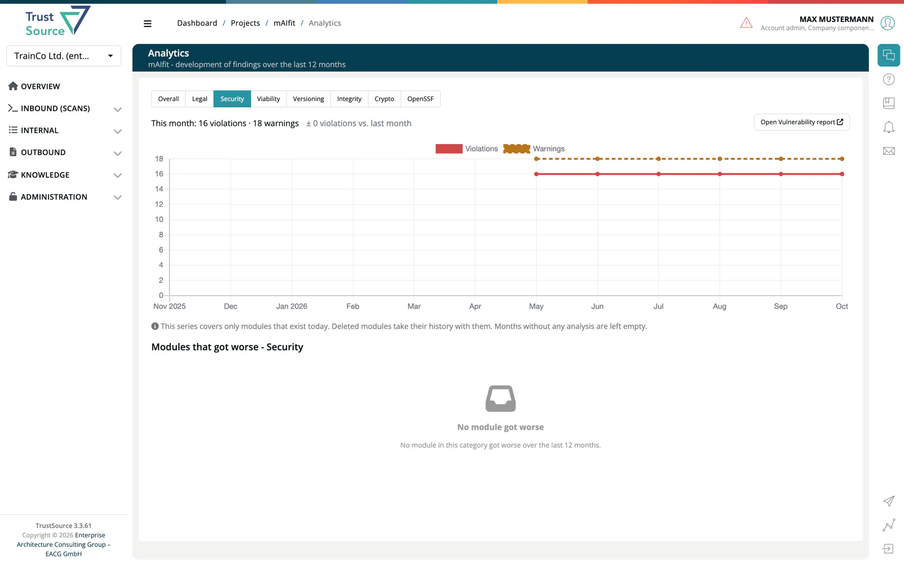

# Analytics

> [!NOTE]
> **Required role:** `developer`, `compliance_manager`, `manager` or `account_admin`

The **Analytics** page charts how the findings of a project developed over the last 12 months. Open it from the **Analytics** tile on the [project page](02-project-overview.md).

## The tile

The tile shows the current number of violations and warnings, the change against last month (for example "+2 violations vs. last month"), a small bar chart and the age of the last analysis (plus the number of outdated modules, if any). A project without any analysis shows "No analysis yet"; run **Analyze all** in the module list below.

## The page

1. Pick a **category**: Overall, Legal, Security, Viability, Versioning, Integrity, Crypto or OpenSSF.
2. Read the headline ("This month: 4 violations · 9 warnings") and the chart of violations and warnings per month. Months without an analysis stay empty.
3. Click **Open ... report** to jump to the matching report (Licenses, Vulnerability, Viability, Versioning, Algorithms, OpenSSF). Overall and Integrity have no report.
4. The table **Modules that got worse** lists the modules whose numbers rose in the chosen category.

> [!NOTE]
> The series covers only modules that exist today. A deleted module takes its history with it.

## Related

- [Project overview](02-project-overview.md)
