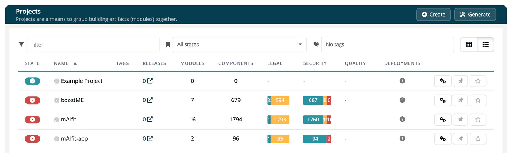

# Projects

A **project** in ***TrustSource*** is an organisational container that groups related modules. Think of it as one software product line, one business unit, or one team's scope. Projects carry their own legal settings, obligation policies, integration credentials and default managers.

## In this section

| Page | What it covers |
|---|---|
| [Create & List](01-create-and-list.md) | How to create a project and navigate the project list. |
| [Project Overview](02-project-overview.md) | The project page: header, Reports menu, the four tiles and the module list. |
| [Deployments](03-deployments.md) | The newest OBOM per deployment and the comparison of two deployments. |
| [Analytics](04-analytics.md) | Violations and warnings of the project over the last 12 months. |
| [Risks and Releases](05-risks-and-releases.md) | The project-bound Risks and Releases pages. |
| [Project Settings](settings/index.md) | The settings tabs: General, Legal, Quality, Crypto management, CIA, End-of-life, Allow/Deny, MDR/IVDR Classification (Medical accounts), Issue Integration, Webhooks and Channels, Danger Operations. Resolved obligations and Imports are pages in the Reports menu. |

## Key concepts

- A module belongs to at most one project. A project can contain many modules. Modules without a project are collected under **Unassigned Modules** in the project list.
- Project-level settings act as **defaults** that modules inherit. Modules can override where it makes sense.
- Projects have a **traffic-light status** (OK, Warnings, Violations) that rolls up from their modules.
- The **default project manager**, **default compliance manager** and **members** are set per project and can be propagated to all its modules.
- Who sees a project: a project without members is visible to all users with access to Projects. Once members are set, only the members, the default project manager and the default compliance manager see it. Portfolio managers see all projects of the company.

