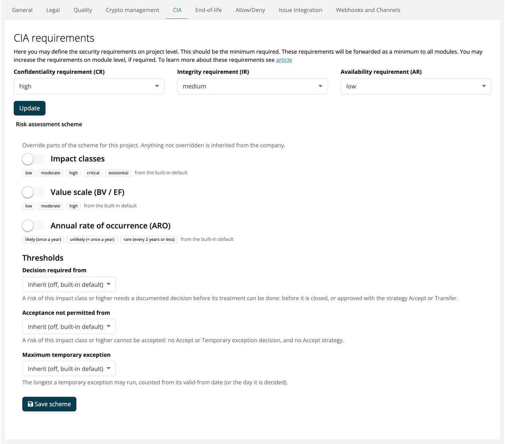

# CIA (Project)

> [!NOTE]
> **Required role:** everyone who can open the project settings reads the values. `company_security_manager`, and `manager` users who are the project's default project manager (or any `manager` while none is set), can edit them and use **Import CIA requirements from...**.

The CIA tab (heading **CIA requirements**) sets the Confidentiality, Integrity and Availability requirements at the project level. The tab describes them as the minimum that is forwarded to all modules; a module can set its own values on its [CIA tab](../../02-modules/settings/08-cia.md).

## Fields

| Field | Options |
|---|---|
| **Confidentiality requirement (CR)** | not defined, low, medium, high |
| **Integrity requirement (IR)** | same |
| **Availability requirement (AR)** | same |

Click **Update** to save.

## Actions

- **Import CIA requirements from...**: copy the CIA requirements of another project.

> [!NOTE]
> The requirements are stored with every module analysis and are part of the environmental context that the REST API returns for projects and modules, next to the environmental CVSS vector set with **Env. settings** on the module page. The CVSS scores of findings are adjusted with that environmental vector, not with the CIA requirements.

## Impact class proposals for risks

The CIA requirements of a module and its project (the stricter value counts) also weigh the impact class that ***TrustSource*** proposes for automatically created risks. A high requirement raises the proposal, a low one lowers it. The **Risks** tile on the project page shows the project's CIA rating. See [Risks List](../../05-risks/02-risks-list.md#proposed-impact-class).

## Risk assessment scheme

Below the requirements, the panel **Risk assessment scheme** lets you override the company's [risk assessment scheme](../../05-risks/07-risk-assessment-scheme.md) for this project: impact classes, value scale, ARO scale and decision thresholds. It needs the `risks` feature and the role `account_admin`, `manager` or `compliance_manager`. Modules of the project inherit the override.
