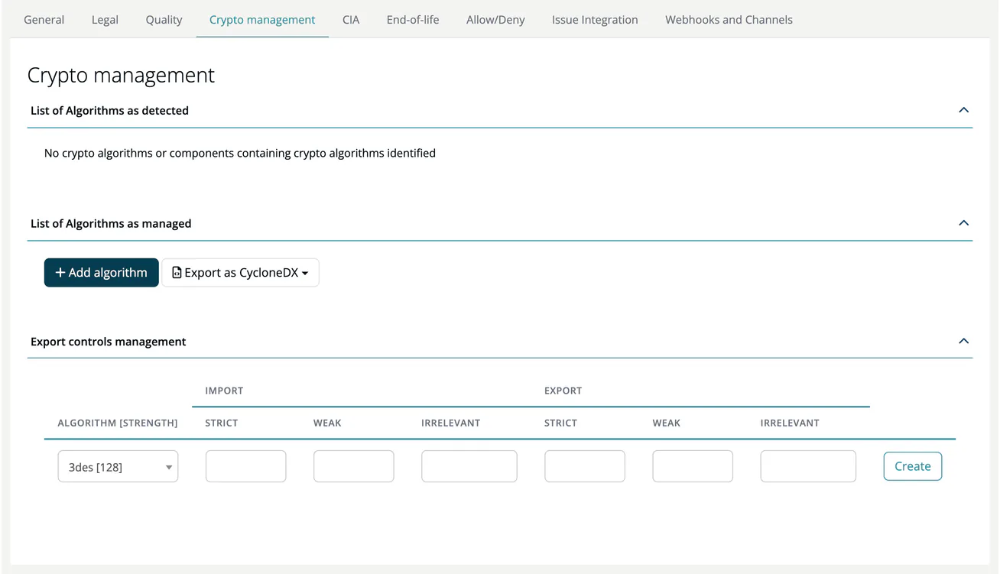

# Crypto management (Project)

> [!NOTE]
> **Required role:** everyone who can open the project settings reads the tab. `manager` users who are the project's default project manager (or any `manager` while none is set) can change it. **Add algorithm** and **Export as CycloneDX** are shown to `manager` and `compliance_manager`.

The Crypto management tab keeps the cryptographic inventory and the export-control rules of the project.

## Panels

| Panel | What it holds |
|---|---|
| **List of Algorithms as detected** | One label per algorithm found in the project's components, for example `AES [256]`. A red **B** marks an algorithm denied by company policy. Without findings the panel reads *No crypto algorithms or components containing crypto algorithms identified*. |
| **List of Algorithms as managed** | Crypto assets you maintain yourself. **Add algorithm** opens the **Algorithm evaluation** dialog: enter the **Name** (the algorithm database and your company's own algorithms are suggested as you type) and optionally the asset type, primitive, mode, padding, functions, environment, platform, certification level, security levels, a **Comment**, **In use** and **Origin**, then click **Add**. |
| **Export controls management** | One row per algorithm and strength with the countries for which import and export are **Strict**, **Weak** or **Irrelevant**. Select the algorithm and countries and click **Create**. |

**Export as CycloneDX** offers **CBOM** (the cryptographic assets only) and **Full BOM (components + crypto + AI)**.

Violations of these lists appear in the Algorithm report and the module's crypto status.

## Related

- [Encryption (Module)](../../02-modules/settings/10-encryption.md): module-level encryption settings
- [Algorithms](../../../05-knowledge/05-algorithms.md): the global algorithm database
- [Background: Crypto Agility](../../../../shared/background/06-crypto-agility.md)
