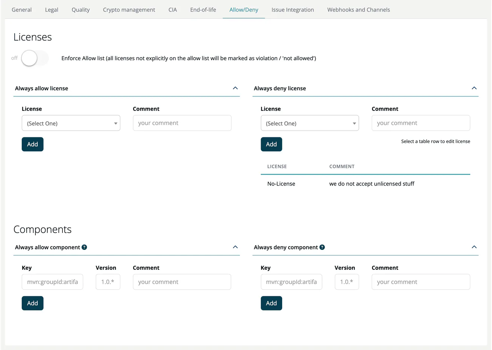

# Allow/Deny (Project)

> [!NOTE]
> **Required role:** everyone who can open the project settings reads the lists. `compliance_manager`, and `manager` users who are the project's default project manager (or any `manager` while none is set), can change them. **Approve** is for `compliance_manager`.

The Allow/Deny tab lets you define which licenses and components are explicitly permitted or forbidden in this project.

## Enforce allow list

The switch **Enforce Allow list (all licenses not explicitly on the allow list will be marked as violation / 'not allowed')** makes the allow list mandatory: every license that is not explicitly allowed is treated as a violation. When it is off, only items on the deny lists are flagged. Turning it on or off asks *Are you sure you want to update Enforce allow settings?*; after **Yes, update settings!** all modules of the project are re-analysed.

## Licenses

| Panel | Effect |
|---|---|
| **Always allow license** | These licenses are always OK, regardless of other rules. |
| **Always deny license** | These licenses are always a violation. |

Select the license, write a comment and click **Add**. A license cannot be on both lists.

## Components

| Panel | Effect |
|---|---|
| **Always allow component** | These components are always permitted. |
| **Always deny component** | These components are always forbidden. |

Each entry has a **Key** (for example `mvn:groupId:artifact`), a **Version** (wildcards such as `1.0.*` are allowed) and a **Comment**. The question-mark icon next to the panel title explains the rules.

Click a row to load it into the form: **Add** becomes **Update**, and **Cancel** and **Remove** appear. Rows labelled **in Company** come from the company lists.

## Approval of entries

When the allow list is enforced, entries that are not added by a compliance manager are saved as **Not approved**. A compliance manager selects the row and clicks **Approve**, or **Reject** to delete it.

> [!NOTE]
> Whether a component was modified and whether it is loosely coupled is not set on this tab. You set it per component in the **Settings** section of the [component side panel](../../02-modules/04-component-detail.md) (**Component was not modified**, **Loose coupling architecture**).

## Related

- [Whitelists & Blacklists (Module)](../../02-modules/settings/14-whitelists-blacklists.md): module-level overrides
- [Open Source Policy](../../../05-knowledge/07-open-source-policy.md): company-wide policy rules
