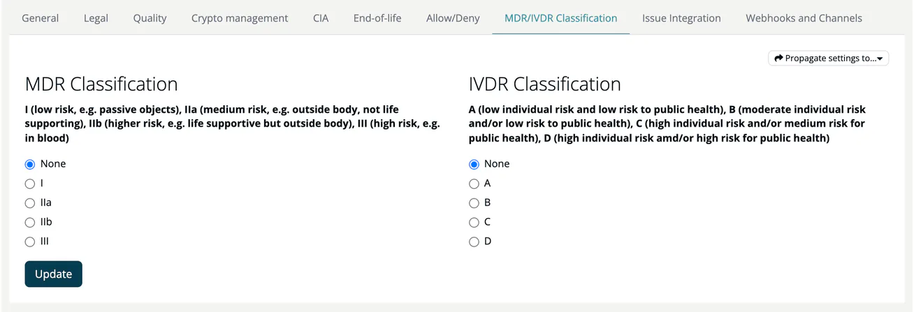

# MDR/IVDR Classification (Project)

> [!NOTE]
> **Required role:** everyone who can open the project settings reads the values. Editing, import and propagate are for `manager` and `compliance_manager` users who are the project's default project manager or default compliance manager (or any of them while none is set).
> **Required account type:** Medical

The MDR/IVDR Classification tab lets you set MDR (Medical Device Regulation) and IVDR (In Vitro Diagnostic Regulation) classifications at the project level.

## Fields

| Field | Options |
|---|---|
| **MDR Classification** | None, I, IIa, IIb, III |
| **IVDR Classification** | None, A, B, C, D |

Click **Update** to save.

## Actions

- **Import settings from Project**: copy the classification from another project (with a name search). The button only appears when another project already has a classification set.
- **Propagate settings to...**: push the classification to one other project or to **All my n projects**. Portfolio managers also see **All n projects**. The button only appears when there are other projects you can propagate to (projects where you are the default project or compliance manager, or projects without managers).

> [!NOTE]
> This tab is only visible for Medical accounts. See [Account Types](../../../00-getting-started/02-account-types.md) for edition details.

