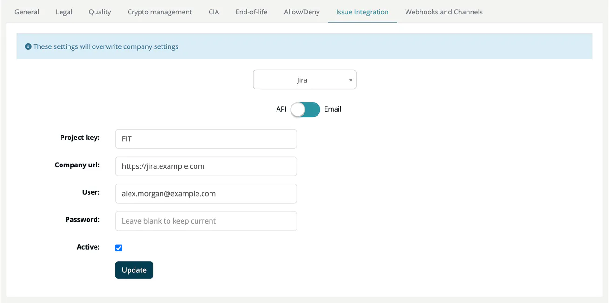

# Issue Integration (Project)

> [!NOTE]
> **Required role:** `developer`, `compliance_manager`, `portfolio_manager`, `manager` and `account_admin` see the tab. `account_admin`, and `manager` users who are the project's default project manager (or any `manager` while none is set) can change it.
> **Required plan:** a project-level integration needs a plan that includes it. Otherwise the tab shows a note that an enterprise account type is needed, and the fields are disabled.

The Issue Integration tab configures where ***TrustSource*** creates issues for this project: in TFS (Azure DevOps), Jira or GitHub. The info line *These settings will overwrite company settings* reminds you that the project values take precedence over the company integration under [Issue Trackers](../../../06-administration/08a-issue-trackers.md).

## Choose the tracker

Select the tracker in the list at the top: **TFS**, **Jira** or **GitHub issues**. The tab opens on the tracker that is active for the project.

## Fields

| Tracker | Fields |
|---|---|
| **TFS** (Azure DevOps) | **Account or URL**, **Project**, **Access Token**, **Active**. |
| **Jira** | Switch **API** / **Email**. API: **Project key**, **Company url**, **User**, **Password**, **Active**. Email: **Project key**, **Email address** (the receiver address of your Jira email handler), **Active**. |
| **GitHub issues** | **Access Token** (required), **Repository** (optional), **Active** (required). |

Password and token fields stay empty after saving; leave them blank to keep the stored value. Click **Update** to save.

> [!TIP]
> Store credentials as API tokens rather than passwords where possible. Jira Cloud requires an API token; a GitHub token needs permission to create issues in the repository.

## Related

- [Issue Trackers](../../../06-administration/08a-issue-trackers.md): company-wide configuration
- [Integrations](../../../06-administration/08-integrations.md)
- [SW Quality Scans](../../../02-inbound/04-sw-quality-scans.md): creating issues from test findings
