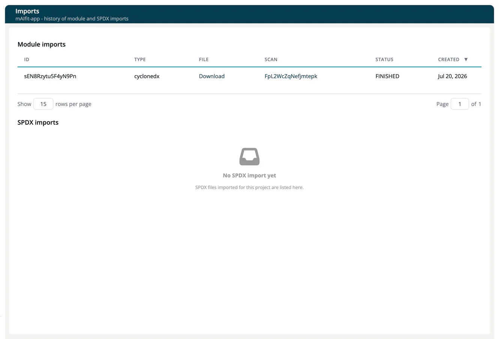

# Imports (Project)

> [!NOTE]
> **Required role:** `developer`, `compliance_manager`, `portfolio_manager` or `manager` (read access to the project's import history).

The **Imports** page shows the history of module and SPDX imports for this project. It is not a settings tab: open it from the **Reports** dropdown in the project page header (below **Resolved obligations**).

The page has two tables, **Module imports** and **SPDX imports**, with the columns **ID**, **File**, **Scan**, **Status** and **Created** (module imports also show the **Type**, for example `cyclonedx`). An empty table says *No module import yet* or *No SPDX import yet*. The page is read-only. To import modules, use the **Import** button in the module list toolbar on the project page.

## Related

- [Create & List Modules](../../02-modules/01-create-and-list.md): creating modules individually
- [Working with Scans](../../../02-inbound/02-import-scans.md): importing scan data
- [Project Overview](../02-project-overview.md): the Reports dropdown
