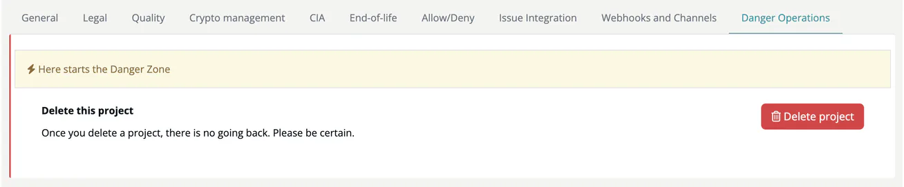

# Danger Operations (Project)

> [!NOTE]
> **Required role:** `manager` users who are the project's default project manager (or any `manager` while the project has none). Other users do not see the tab.

The Danger Operations tab opens with the banner *Here starts the Danger Zone* and offers one operation: **Delete this project**.

## Delete project

- **Project without modules:** click **Delete project** and confirm *Are you sure you want to delete project ...?* with **Yes, delete it!**
- **Project with modules:** **Delete project** is disabled and an info box asks you to unassign all related modules first, or to **click here and all modules will be removed**. That link asks *Are you sure you want to delete project ... and all modules?* and, after **Yes, delete it!**, deletes the project together with all its modules.

After deletion you return to the project list.

> [!CAUTION]
> Deleting a project is **permanent and cannot be undone**. All project settings and, when you delete the modules too, all module data, scans and approvals are lost. Projects cannot be archived. To keep modules, move them to another project in their [General settings](../../02-modules/settings/01-general.md) first, or archive modules you no longer need in their [Danger Operations](../../02-modules/settings/18-danger-zone.md).

