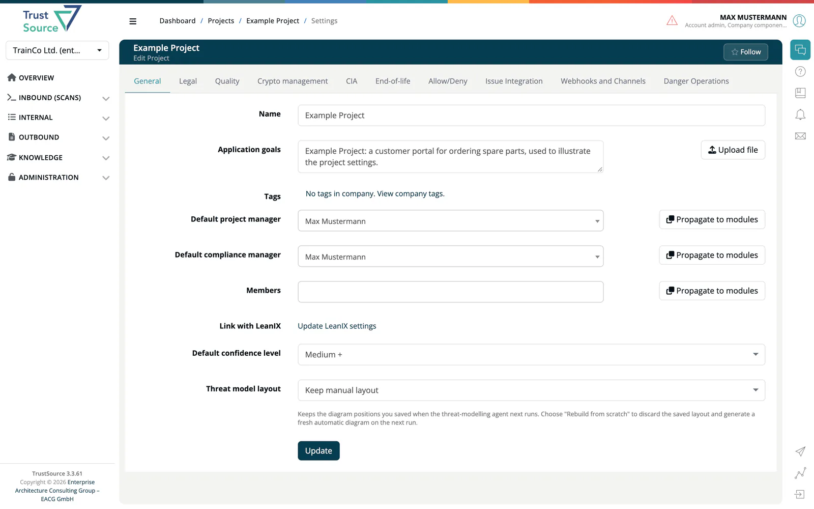

# Project Settings

Open the project settings with the cogs icon on the [project page](../02-project-overview.md) or in the project list. The page header shows the project name, the subtitle *Edit Project* and a **Follow** action. Settings are organized in tabs, in the order below (MDR/IVDR Classification only for Medical accounts). A tab is shown only if your role may read it; **Webhooks and Channels** is always shown. Settings defined here act as **defaults** for all modules in the project; modules can override most values.

| Tab | What it configures |
|---|---|
| [General](01-general.md) | Name, application goals, tags, default managers, members, LeanIX link, default confidence level, threat model layout. |
| [Legal](02-legal.md) | Commercial aspects, operating model, inbound and outbound IP protection. |
| [Quality](04-quality.md) | Required test tools and automatic risk creation. |
| [Crypto management](05-encryption.md) | Detected and managed algorithms, export controls. |
| [CIA](03-cia.md) | Confidentiality, Integrity, Availability requirement levels and the risk assessment scheme override. |
| [End-of-life](06-end-of-life.md) | EOL analysis toggle, warning and violation thresholds. |
| [Allow/Deny](07-whitelists-blacklists.md) | Enforce allow list; always allowed and always denied licenses and components. |
| [MDR/IVDR Classification](09-module-classification.md) | MDR/IVDR classification (Medical accounts). |
| [Issue Integration](10-issue-tracker.md) | TFS, Jira or GitHub issues for this project. |
| [Webhooks and Channels](13-webhooks-channels.md) | Webhooks and chat channels for project events and vulnerability alerts. |
| [Danger Operations](12-danger-zone.md) | Delete the project. |

> [!NOTE]
> **Resolved obligations** and **Imports** used to be settings tabs. They are now pages in the **Reports** dropdown of the project page: [Resolved obligations](08-obligations.md) and [Imports](11-module-import.md).

> [!TIP]
> On the General tab, **Propagate to modules** pushes the tags, default managers or members to all modules of the project at once. Legal and MDR/IVDR Classification offer **Propagate settings to...**, which copies the settings to other projects.

