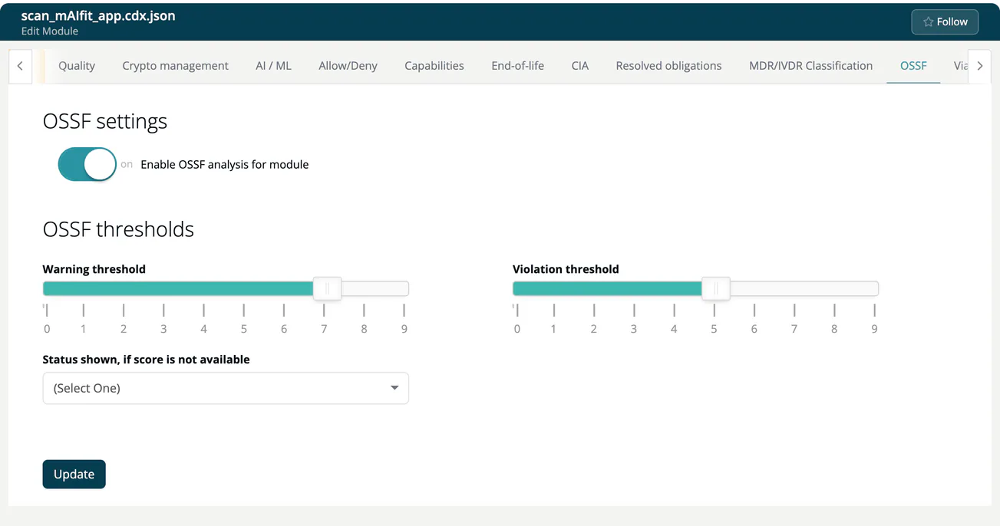

# OSSF (Module)

> [!NOTE]
> **Required role:** everyone who can open the module settings reads the tab. Editing is for developers and for managers and compliance managers who are the module's default manager (or if none is set). Saving is also checked on the server, which accepts account admins, managers and compliance managers. See the [Settings Permission Matrix](../../../10-roles-permissions/06-settings-permission-matrix.md).

The OpenSSF Scorecard rates the security practices of an open-source repository on a scale of 0 to 10. On this tab you decide which scores make a component a warning or a violation in this module. The tab is also available for infrastructure modules.

## Steps

1. Turn on **Enable OSSF analysis for module**.
2. Confirm *Are you sure you want to update OSSF analysis settings?* with **Yes, update settings!** The module is analysed again.
3. Set the **OSSF thresholds** and click **Update**. A toast confirms *OSSF settings changed!*.

## Fields

| Field | Meaning |
|---|---|
| **Warning threshold** | Scorecard value (0-9) at which a component becomes a warning. |
| **Violation threshold** | Scorecard value (0-9) at which a component becomes a violation. |
| **Status shown, if score is not available** | `OK`, `Warning` or `Violation` for components without a score. |

The warning threshold must not be lower than the violation threshold, unless it is `0`. A new module starts with warning `7` and violation `5`.

> [!NOTE]
> Components without a repository cannot be scored. To fill the gaps, use **Score missing components** in the [OpenSSF Scorecard report](../../04b-analysis-reports.md#openssf-scorecard-report).

