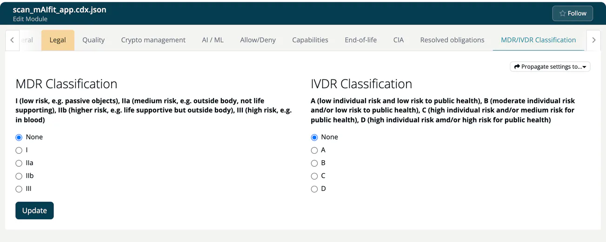

# MDR/IVDR Classification (Module)

> [!NOTE]
> **Required account type:** Medical. The tab does not appear for other account types, nor for infrastructure modules.
> **Required role:** everyone who can open the module settings reads the tab. Editing, **Import** and **Propagate** are for developers and for managers and compliance managers who are the module's default manager (or if none is set). Saving is also checked on the server, which accepts account admins, managers and compliance managers.

Medical software is regulated by the class of the device it belongs to. This tab records the class of the module under the Medical Device Regulation (MDR) or the In Vitro Diagnostic Regulation (IVDR), which the SoUP report shows. Set the one that matches your product: MDR for a medical device, IVDR for an in vitro diagnostic device.

## Fields

| Field | Options |
|---|---|
| **MDR Classification** | `None`, `I` (low risk, e.g. passive objects), `IIa` (medium risk, e.g. outside the body, not life supporting), `IIb` (higher risk, e.g. life supportive but outside the body), `III` (high risk, e.g. in blood) |
| **IVDR Classification** | `None`, `A` (low individual risk and low risk to public health), `B` (moderate individual risk and/or low risk to public health), `C` (high individual risk and/or medium risk for public health), `D` (high individual risk and/or high risk for public health) |

Select the class and click **Update**. A toast confirms *Classification settings changed!*. Without write rights the radio buttons are greyed out.

## Import and propagate

- **Import settings from Module** copies the classification of another module into this one.
- **Propagate settings to...** pushes this module's classification to one other module, to **All my n modules**, or to **All my n project modules**. Portfolio managers also see **All n modules** and **All n project modules**. "My" modules are those where you are default project manager or default compliance manager.

> [!CAUTION]
> Propagating overwrites the classification of every target module without a confirmation dialog.

## Related

- [MDR/IVDR Classification (Project)](../../01-projects/settings/09-module-classification.md)
- [Medical capability](../../../13-capabilities/04-medical.md)
- [MDR SoUP workflow](../../../recipes/05-mdr-soup-workflow.md) and [SoUP lists](../../../04-outbound/03-soup-lists.md)

