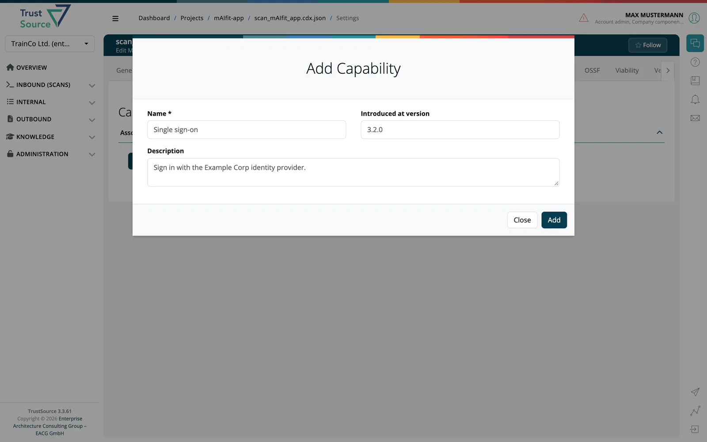

# Capabilities (Module)

> [!NOTE]
> **Required role:** everyone who can open the module settings reads the list. **Add capability**, edit and remove are for developers, compliance managers, portfolio managers, managers and company security managers. See the [Settings Permission Matrix](../../../10-roles-permissions/06-settings-permission-matrix.md).

A capability states what a module can do for its users, for example *Single sign-on* or *Export invoices as PDF*. Declare them once on the module; they then appear in the Capabilities tab of its [approvals](../../06-approvals/02-approval-detail-tabs.md) and in the Capabilities column of the [Solutions tab](../../03-products/03-tab-solutions.md) of products. The tab is not shown for infrastructure modules.

## Add a capability

1. Click **Add capability**.
2. Enter a **Name** (required), for example `Single sign-on`.
3. Optionally enter the version it was **Introduced at version**, for example `3.2.0`, and a **Description**.
4. Click **Add**.

## The list

The panel **Associate capabilities with this module** lists each capability with these columns:

| Column | Content |
|---|---|
| **Name** | The capability. |
| **Description** | Your text. |
| **Introduced at version** | The first version that offers it. |
| **Added** / **by** | When and by whom it was created. |
| **Modified** / **by** | The last change. |

The pencil icon at the end of a row edits a capability, the trash icon removes it. Both are available only with write rights.

