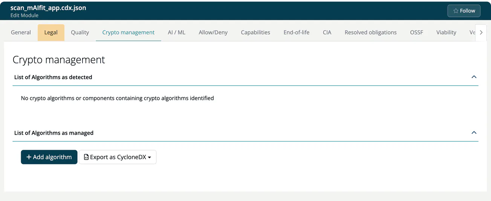

# Crypto management (Module)

> [!NOTE]
> **Required role:** everyone who can open the module settings reads the tab. Editing is for developers and for managers and compliance managers who are the module's default manager (or if none is set). **Add algorithm** and the CycloneDX export buttons show for managers and compliance managers. See the [Settings Permission Matrix](../../../10-roles-permissions/06-settings-permission-matrix.md).

This tab keeps the cryptographic inventory of the module. ***TrustSource*** lists the algorithms it detected in the components, and you add what the scanner cannot see: algorithms in your own code, certificates, protocols and key material. The tab is not shown for infrastructure modules.

## Detected algorithms

**List of Algorithms as detected** shows one label per algorithm found in the module's components, for example `AES [256]`. A red **B** marks an algorithm that the company policy denies. If nothing was found, the panel says so.

## Managed algorithms

**List of Algorithms as managed** is the list you maintain. Click **Add algorithm** to open the dialog **Algorithm evaluation**:

| Field | Notes |
|---|---|
| **Name** | Required. Suggestions come from the algorithm database; see [Algorithms](../../../05-knowledge/05-algorithms.md). |
| **Asset type** | `algorithm`, `certificate`, `protocol` or `related-crypto-material`. The fields below the type change with it. |
| Algorithm | **Primitive**, **Parameter Set Identifier**, **Elliptic Curve**, **Mode**, **Padding**, **Cryptographic functions**, **Execution Environment**, **Implementation platform**, **Certification Level**, **Classical security level**, **NIST QSL** (0-6). |
| Certificate | **Subject name**, **Issuer name**, **Not valid before**, **Not valid after** (ISO 8601), **Certificate format**, **File extension**, **Serial number**, **State**. |
| Protocol | **Protocol type**, **Version**, for example `1.3`. |
| Related crypto material | **Material type**, **State**, **Size (bits)** and **Format**. |
| **Comment**, **In use**, **Origin** | Free text and a checkbox for every asset type. |

Click **Add**; the toast says *Algorithm settings added*. The table shows **Added**, **B**, **Name**, **Asset type**, **Details**, **Comment** and **In use**. The pencil edits an entry (dialog **Edit crypto asset**), the trash icon removes it. Entries inherited from the project are labelled **in Project** and can be changed only there.

## Export

**Export as CycloneDX** offers **CBOM** (only the cryptographic assets) and **Full BOM (components + crypto + AI)**.

> [!TIP]
> New to the topic? Read [Crypto Agility](../../../../shared/background/06-crypto-agility.md) and the [crypto inventory recipe](../../../recipes/07-crypto-inventory-pqc.md).

## Related

- [Crypto management (Project)](../../01-projects/settings/05-encryption.md)
- [Algorithm report](../../04b-analysis-reports.md#algorithm-report)

