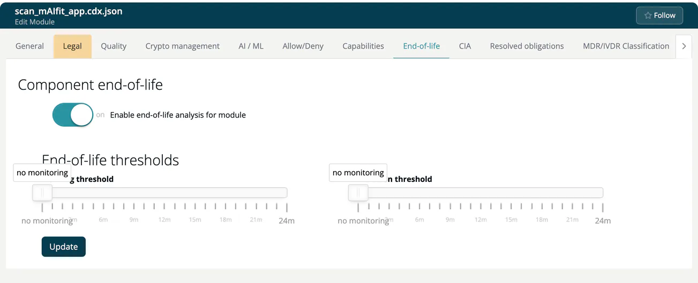

# End-of-life (Module)

> [!NOTE]
> **Required role:** everyone who can open the module settings reads the tab. Editing is for developers and for managers and compliance managers who are the module's default manager (or if none is set). Saving is also checked on the server, which accepts account admins, managers and compliance managers. See the [Settings Permission Matrix](../../../10-roles-permissions/06-settings-permission-matrix.md).

Software that has reached its end of life no longer gets security fixes. This tab controls when ***TrustSource*** flags such components in this module, for example a `debian:11` base image or a Node.js 16 runtime.

## Steps

1. Turn on **Enable end-of-life analysis for module**.
2. Confirm *Are you sure you want to update end-of-life policy?* (*This will affect all future analysis!*) with **Yes, update settings!**
3. Under **End-of-life thresholds**, set the **Warning threshold** and the **Violation threshold**. Both are sliders from `no monitoring` to `24m` (months).
4. Click **Update**. A toast confirms *Module end-of-life policy successfully changed*.

The warning threshold must not be lower than the violation threshold, unless it is `no monitoring`. Otherwise the form shows *'Warning threshold' must not be lower than 'Violation threshold'*. A module that is saved is marked for a new analysis.

The thresholds appear only while the switch is on.

## Where the result shows

The module's component views show end-of-life status for components. The project-wide list is the End-of-life report, see [Analysis Reports](../../04b-analysis-reports.md#end-of-life-report).

> [!NOTE]
> The same policy exists on company level (**Settings → Policies**, see [Policies](../../../06-administration/05-policies.md)) and on project level ([End-of-life (Project)](../../01-projects/settings/06-end-of-life.md)).

