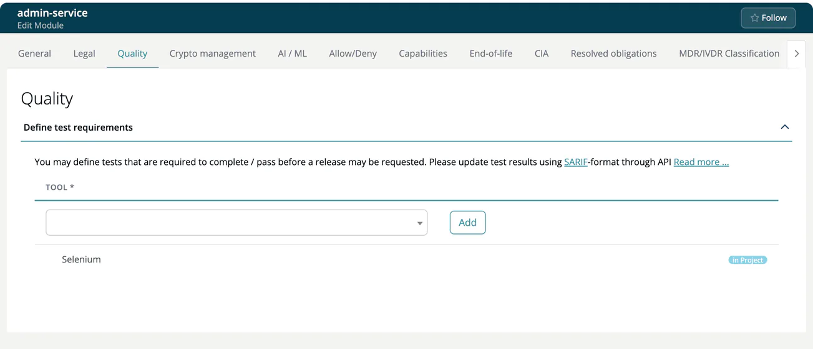

# Quality (Module)

> [!NOTE]
> **Required role:** everyone who can open the module settings reads the tab. Adding and removing tools is for developers and for managers and compliance managers who are the module's default manager (or if none is set). See the [Settings Permission Matrix](../../../10-roles-permissions/06-settings-permission-matrix.md).

Define which quality tests must be completed and passed before a release of this module may be requested. Tests are fed by tools that report in SARIF format, for example Semgrep, CodeQL or Bandit. The tab is not shown for infrastructure modules.

## Define test requirements

The panel **Define test requirements** has one row per required tool.

1. Select a **Tool** from the list. It contains the test tools known to your company.
2. Click **Add**. If no tool is selected, you see *Test tool is required*.
3. To drop a requirement, click the trash icon at the end of its row. A toast confirms *Successfully removed*.

Rows inherited from the project settings or from the company's quality lists carry the label **in Project** or **in Company** instead of the trash icon. The label links to the place where you can change them.

## How it is used

Upload the test results of every required tool as SARIF with the module's scans, see [SW Quality Scans (SARIF)](../../../02-inbound/04-sw-quality-scans.md). The approval then evaluates the results in its SW Quality tab, see [Approval detail tabs](../../06-approvals/02-approval-detail-tabs.md). Uploading and reviewing results needs the `sarif` license.

## Related

- [Quality (Project)](../../01-projects/settings/04-quality.md)

