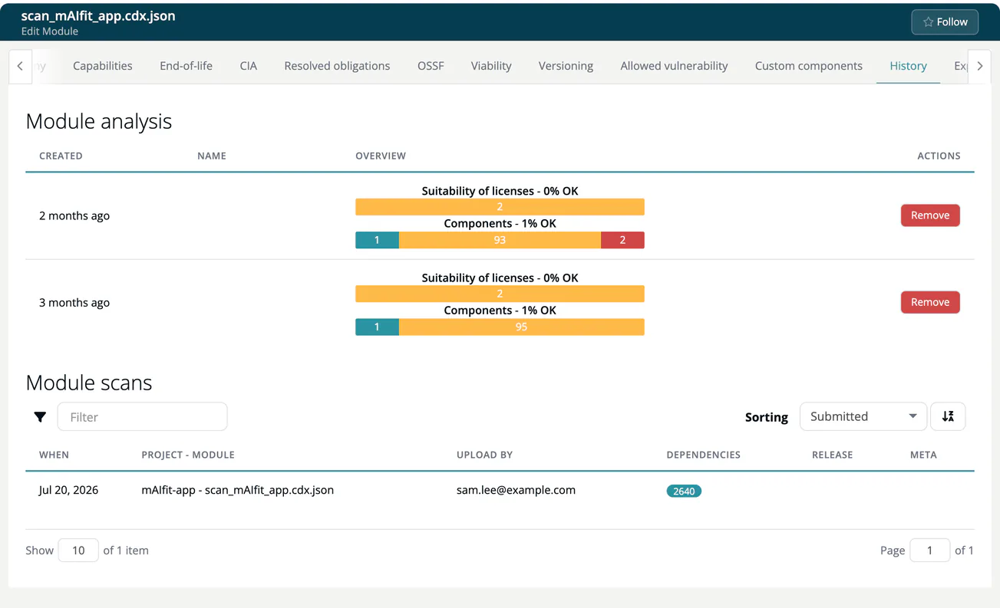

# History (Module)

> [!NOTE]
> **Required role:** everyone who can open the module settings reads the tab. **Remove** on an analysis is for managers and compliance managers who are the module's default manager (or if none is set). See the [Settings Permission Matrix](../../../10-roles-permissions/06-settings-permission-matrix.md).

The tab is called **History** in the app. It shows what has been analysed and uploaded for the module so far. Use it to check whether the latest scan arrived and to remove an analysis that should not count any more. The tab is not shown for infrastructure modules.

## Module analysis

Every analysis run leaves one row:

| Column | Content |
|---|---|
| **Created** | How long ago the analysis ran. |
| **Name** | The release name of the analysis. |
| **Overview** | Two bars: **Suitability of licenses** and **Components**. |
| **Actions** | **Remove**. |

**Remove** deletes that single analysis at once, without a confirmation. A toast confirms *Analysis successfully deleted*.

> [!WARNING]
> Removing an analysis cannot be undone. To delete all of them, use **Delete history** in the [Danger Operations](18-danger-zone.md) tab.

## Module scans

The table lists every scan uploaded for this module, newest first:

| Column | Content |
|---|---|
| **When** | Upload time. |
| **Project - Module** | For example `Checkout Platform - payment-service`. |
| **Upload by** | The user who uploaded it. |
| **Dependencies** | Number of dependencies in the scan. |
| **Release** | The release name given at upload. |
| **Meta** | Branch and tag, if the scan carried them. |

You can filter by project, module, user, branch and tag.

How scans get into a module is described in [Inbound](../../../02-inbound/index.md).

