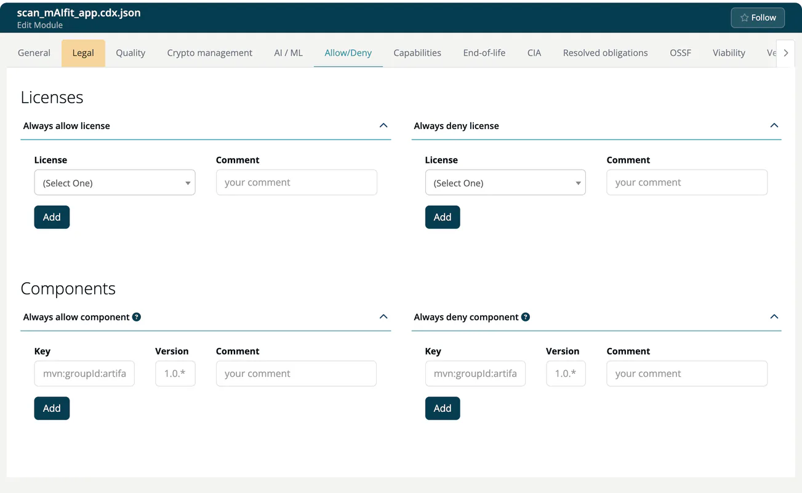

# Allow/Deny (Module)

> [!NOTE]
> **Required role:** everyone who can open the module settings reads the lists. Adding, changing and removing entries is for developers and for managers and compliance managers who are the module's default manager (or if none is set). **Approve** is for compliance managers who are the module's default compliance manager (or if none is set). See the [Settings Permission Matrix](../../../10-roles-permissions/06-settings-permission-matrix.md).

Allow/Deny lists let you overrule the automatic evaluation for this module: a license you have cleared with legal, or a component you never want to ship. The tab is not shown for infrastructure modules.

## Licenses

Two panels, **Always allow license** and **Always deny license**.

1. Select the **License** and write a **Comment** of up to 200 characters, for example *Cleared by legal, ticket LEG-212*. The comment is required.
2. Click **Add**.

A license cannot be on both lists; a duplicate is refused with *Entry already exists*.

## Components

Two panels, **Always allow component** and **Always deny component**.

| Field | Format |
|---|---|
| **Key** | Package type and name, for example `mvn:com.acme.billing:invoice-core`. |
| **Version** | For example `3.6.1`. |
| **Comment** | Required, up to 200 characters. |

- **Always allow**: the component is left out of the result evaluation.
- **Always deny**: the component always fails the evaluation.

Use a wildcard `*` as the last character of the key or of a key part (parts are separated by `:`), and as the last character of the version. `mvn:com.acme.billing:*` covers all artifacts of the group, `*:acme:*` every package type with the group `acme`, and `1.*` every 1.x version. The question-mark icon next to the panel title shows these examples.

## Edit and remove

Click a row to load it into the form: **Add** becomes **Update**, and **Cancel** and **Remove** appear. Rows labelled **in Project**, **in User** or **in Company** come from higher levels; the label links to the place where you can change them.

## Approval of entries

If your company or the project requires approved allow lists (the company switch **Enforce allow** on the company's License allow/deny page, see [Settings](../../../06-administration/02-settings.md)), an entry added by anyone but a compliance manager is saved as **Not approved** and the compliance managers are notified. A compliance manager selects the row and clicks **Approve**, or **Reject** to delete it.

## Related

- [Allow/Deny (Project)](../../01-projects/settings/07-whitelists-blacklists.md)
- [Open Source Policy](../../../05-knowledge/07-open-source-policy.md)

