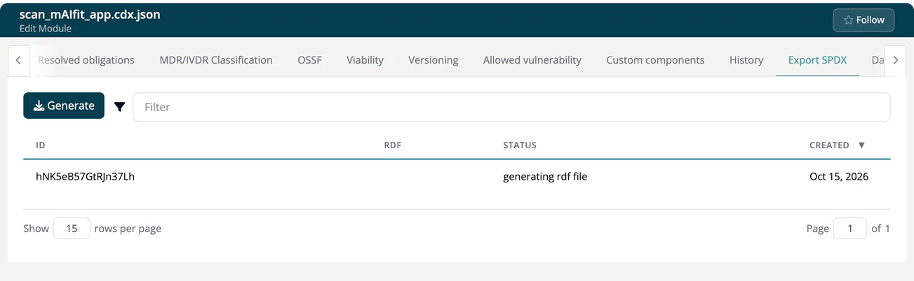

# Export SPDX (Module)

> [!NOTE]
> **Required role:** developers, compliance managers, managers and portfolio managers see the tab. **Generate** is for the same roles. See the [Settings Permission Matrix](../../../10-roles-permissions/06-settings-permission-matrix.md).

Create an SPDX document for the module, the format many customers and authorities ask for to describe the software bill of materials. The tab is not shown for infrastructure modules.

## Generate a document

1. Click **Generate**.
2. A toast confirms *SPDX generation successfully added to queue!* The document is built in the background.
3. Watch the **Status** column of the table. It moves from `created` to `generating rdf file` and ends with `finished`.
4. Click **Download RDF** in the **RDF** column.

If the request cannot be queued, the toast reads *Error: could not add to queue!* (or the reason given by the server).

## The table

| Column | Content |
|---|---|
| **ID** | Identifier of the export. |
| **RDF** | **Download RDF** once the file exists. |
| **Status** | `created`, `generating rdf file` or `finished`. |
| **Created** | When you requested it; newest first. |

Each click on **Generate** creates a new document; earlier ones stay in the list. The table can be filtered and shows 15 rows per page.

> [!NOTE]
> Your account type decides whether SPDX export is part of your plan, see [Roles & Licenses Cheat Sheet](../../../00-getting-started/06-roles-licenses-cheatsheet.md). Without it the export is refused with "SPDX export is not part of your plan". For a full SBOM in CycloneDX, see [SBOM](../../../04-outbound/01-sbom-cbom.md).

