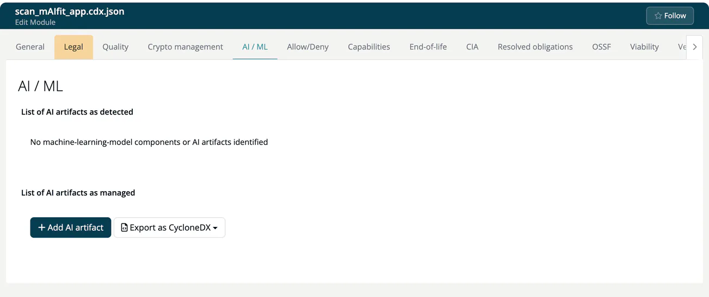

# AI / ML (Module)

> [!NOTE]
> **Required role:** reading follows the Crypto management access right of the module; adding, editing and exporting needs `developer`, `compliance_manager` or `manager`. See [Settings Permission Matrix](../../../10-roles-permissions/06-settings-permission-matrix.md).

The **AI / ML** tab manages the AI artifacts of a module, the basis of its **AIBOM** (AI bill of materials). It has the same structure as [Crypto management](10-encryption.md) and sits next to it. It is not shown for infrastructure and COTS modules.

## List of AI artifacts as detected

The upper panel lists the machine-learning models and AI artifacts that ***TrustSource*** found in the module's components, for example `image-classifier [1.0] · image-classification`. If there are none, it reads *No machine-learning-model components or AI artifacts identified*. Models arrive with a scan or a CycloneDX import.

## List of AI artifacts as managed

The lower panel holds the artifacts you maintain by hand, added to what the scan found. Columns are **Added**, **Name**, **Version**, **Details** (provider, task, family, architecture) and **Comment**.

Click **Add AI artifact** (or the pencil on a row) and fill in:

| Field | Example |
|---|---|
| **Name** (required) | `image-classifier` |
| **Version** | `1.0` |
| **Provider** | `Example AI` |
| **Task** | `image-classification` |
| **Model family** | `vision-transformer` |
| **Architecture** | `ViT-B/16` |
| **PURL** | `pkg:huggingface/example-org/image-classifier@1.0` |
| **Comment** | optional note |

The bin icon removes an artifact.

## Export as CycloneDX

**Export as CycloneDX** offers **AIBOM** (only the AI artifacts) and **Full BOM (components + crypto + AI)**. Both download a JSON file named after the module: `<module name>-aibom-file-0.1.0.json` and `<module name>-full-cyclonedx-0.1.0.json`. The same documents are available through the API, see [Modules](../../../09-rest-api/endpoints/modules.md).

AI models also appear in the **AI / ML models** section of the component side panel; see [Component details](../04-component-detail.md).

## Related

- [Crypto management](10-encryption.md)
- [SBOM and CBOM reports](../../../04-outbound/01-sbom-cbom.md)
