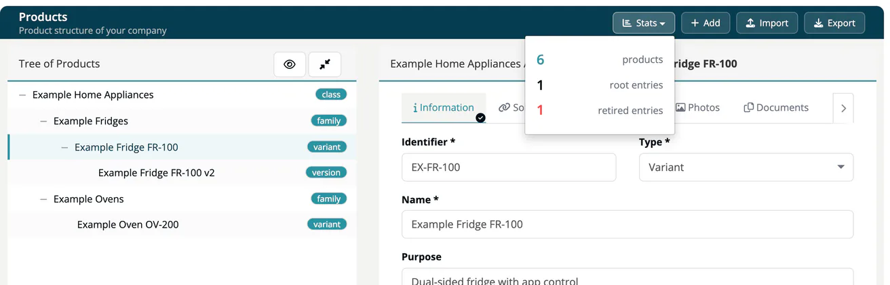

# Create & Import Products

> [!NOTE]
> **Required license feature:** `products`
> Creating and importing needs only the license. Editing an existing product needs the `developer`, `compliance_manager`, `company_security_manager` or `account_admin` role.

Use **Internal → Products** to build the structure of what you ship: a tree of classes, families, variants and versions. You can add products one by one or import a whole structure from a JSON file.

## Add a product

1. Open **Internal → Products** and click **Add**.
2. Optionally pick a **Parent** to place the product below an existing one. If you left a product selected in the tree, it is pre-selected.
3. Enter the **Identifier** (required, for example `FR-100`) and choose the **Type**: Class, Family, Variant, Version or Position.
4. Enter the **Name** (required) and, if you like, the **Purpose**.
5. Click **Add**.

The identifier must be unique within your company. It also serves as the product's key: children refer to their parent by this identifier.

> [!TIP]
> Tick **Draft** to try things out. Draft products are marked with a *Draft* label, and a **Remove drafts** button appears below the tree to delete all of them at once. Removing drafts is available to the `manager`, `compliance_manager`, `company_security_manager` and `account_admin` roles.

New products inherit the PSIRT contact stored in your company settings; see [Contacts](07-tab-contacts.md).

## The product tree

The left panel shows **Tree of Products**. Click a product to open its tabs on the right.

- **Expand all** / **Collapse all** opens or closes every branch.
- **Show all** also lists retired products; **Hide retired** returns to the default view.
- **Stats** shows the number of products, root entries and retired entries.

On screens narrower than 1500 pixels, the tree buttons show only their icons: the eye for **Show all** and **Hide retired**, the arrows for **Expand all** and **Collapse all**.



## Import products

1. Click **Import** in the page header.
2. Optionally tick **Draft** to mark every imported product as a draft.
3. Optionally choose a **Parent**. Imported products that have no parent in the file are placed below it; otherwise they become root entries.
4. Select the **File** (`.json`) and click **Import**.

Click the **JSON** link in the dialog to open a sample file.

### File format

```json
{
  "format": "TrustSourceProducts",
  "version": 1,
  "products": [
    {"type": "class", "identifier": "FR", "name": "Fridges", "description": "Household cooling"},
    {"type": "family", "identifier": "FR-100", "name": "Dual-sided"}
  ],
  "relations": [
    {"identifier": "FR", "contains": ["FR-100"]}
  ]
}
```

- `version` must be `1`.
- Each product needs `identifier`, `name` and `type` (for example `class` or `family`); `description` and `properties` (a list of `{"name": ..., "value": ...}` pairs) are optional.
- `relations` describe the tree: the product in `identifier` contains the products listed in `contains`. A product listed in several relations keeps the first one. The order of products in the file does not matter.
- A relation may point to a product that already exists in your company; it must exist, or the import fails.
- A file may hold up to 5,000 products and 5,000 relations, and you can start up to five imports per minute.

### All or nothing

The import checks the whole file before it creates anything. If a single row is invalid, nothing is imported, and the error names the problem, for example:

- an identifier listed twice in the file, or already used by a product in your company,
- a product without identifier, name or type,
- a relation to an unknown parent, or relations that form a cycle,
- a row that violates the product schema (the message names the row).

Fix the file and import it again. A successful import shows "Products added".

> [!CAUTION]
> A file that is valid JSON but does not carry `"version": 1` is accepted without creating any product. If nothing appears after an import, check the `version` field.

## Export products

Click **Export** to download `products-export.json`. It contains all active (not retired) products with type, identifier, name and description, and their relations, in the format above. Use it for backups or to move a structure to another company; properties, classification, documents and other tab data are not part of the export.

You can create and import products through the [Products API](../../09-rest-api/endpoints/products.md) as well.

## Related

- [Products overview](index.md) - the eight product tabs
- [Link with Release](10-link-with-release.md) - connecting releases to products
