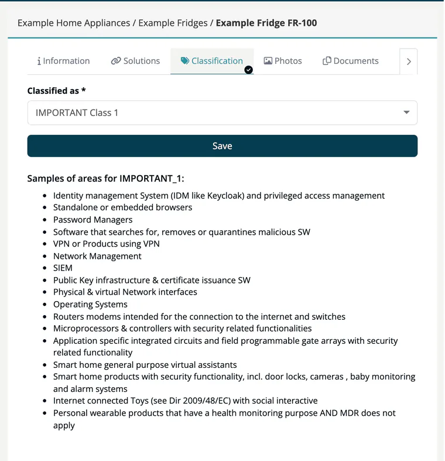

# Tab: Classification (CRA)

> [!NOTE]
> **Required license feature:** `products`
> **Editing:** `developer`, `compliance_manager`, `company_security_manager` or `account_admin`

Use the **Classification** tab to record the product's category under the EU Cyber Resilience Act (CRA). The category determines the conformity assessment procedure you need to follow.

1. Open the tab and choose a value under **Classified as**.
2. Click **Save**.

| Value | Typical products (examples shown in the tab) |
|---|---|
| **STANDARD** | Products under the MDR; products usable only in aviation, maritime or automotive contexts. |
| **IMPORTANT Class 1** | Identity and privileged access management, browsers, password managers, anti-malware software, VPN, network management, SIEM, PKI software, network interfaces, operating systems, routers, modems and switches, security-related microprocessors, ASICs and FPGAs, smart home assistants and security products, connected toys, health wearables outside the MDR. |
| **IMPORTANT Class 2** | Hypervisors and container runtimes, firewalls, intrusion detection and prevention, tamper-resistant microcontrollers. |
| **CRITICAL** | Hardware security boxes, smart meter gateways, secure cryptoprocessors, smartcards and secure elements. |

After you save, the tab lists the example areas of the stored value below the form, under **Samples of areas for ...**, as orientation. Until a value is saved, the list is not shown.

> [!NOTE]
> The examples are a guide, not a legal assessment. ***TrustSource*** stores your choice but does not derive it.

## Related

- [Products overview](index.md) - all eight product tabs
- [Background: Cyber Resilience Act](../../../shared/background/01-cra-cyber-resilience-act.md)
