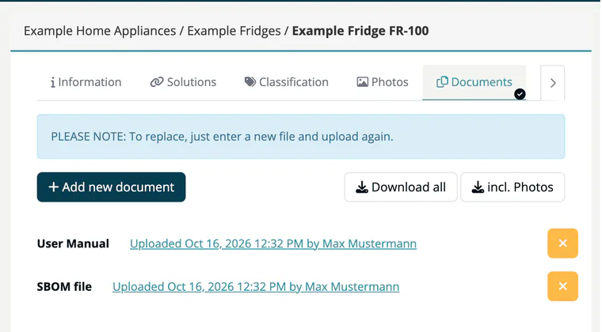

# Tab: Documents

> [!NOTE]
> **Required license feature:** `products`
> **Editing:** `developer`, `compliance_manager`, `company_security_manager` or `account_admin`

The **Documents** tab keeps the documents the CRA expects you to provide with a product. There is one slot per document type.

## Document types

| Type | Used for |
|---|---|
| **User Manual** | Instructions for users. |
| **Secure Setup** | Guidance for installing and operating the product securely. |
| **Product Description** | Description of the product. |
| **SBOM file** | Software bill of materials; can be [generated from the Solutions tab](03-tab-solutions.md#generate-an-sbom). |
| **CE mark declaration** | The declaration of conformity. |

## Upload a document

1. Click **Add new document**. The **Upload product document** dialog opens.
2. Choose the **Document type**.
3. Select the **File** and click **Upload**. Accepted formats: PDF, DOC, DOCX, XLS, XLSX, PPT, PPTX, TXT, RTF, ODT, ODP and ODS.

> [!TIP]
> To replace a document, upload a new file of the same type. The old file is deleted.

Uploaded documents are listed with their type, upload date and uploader; click the entry to download the file. Click the **x** button on a row to remove the document; it is removed at once, without a confirmation.

## Download everything

**Download all** packs all documents into one ZIP archive (it does nothing while no document is uploaded). **incl. Photos** (shown when photos exist) adds the pictures from the [Photos](05-tab-photos.md) tab.

## Related

- [Products overview](index.md) - all eight product tabs
