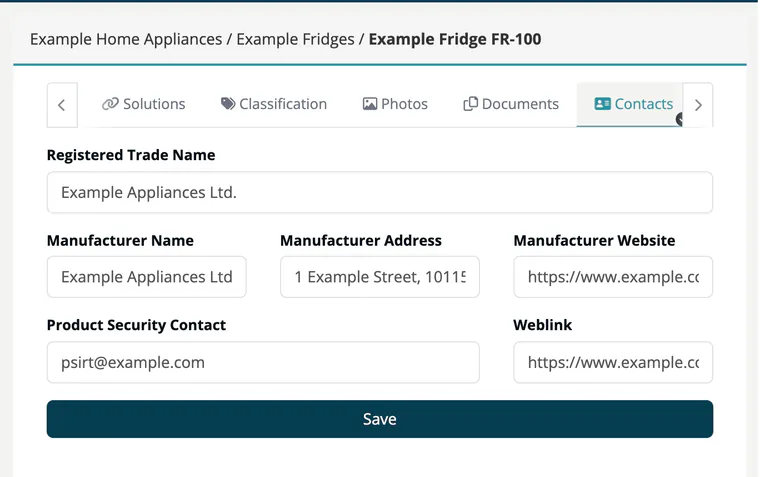

# Tab: Contacts

> [!NOTE]
> **Required license feature:** `products`
> **Editing:** `developer`, `compliance_manager`, `company_security_manager` or `account_admin`

The **Contacts** tab identifies the manufacturer and the contact for security reports. The CRA requires that the manufacturer can be identified on the product.

| Field | Description |
|---|---|
| **Registered Trade Name** | The company name as registered. |
| **Manufacturer Name** | Name of the manufacturer. |
| **Manufacturer Address** | Postal address. |
| **Manufacturer Website** | Web address of the manufacturer. |
| **Product Security Contact** | Where to report vulnerabilities, for example `psirt@example.com`. |
| **Weblink** | Link to your vulnerability disclosure policy or PSIRT page. |

Click **Save** to store the data. All fields are optional.

New products start with the PSIRT data from your company settings, so you only adjust what differs per product.

## Related

- [Products overview](index.md) - all eight product tabs
