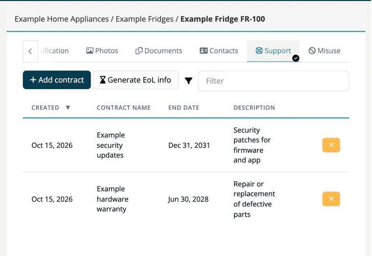

# Tab: Support

> [!NOTE]
> **Required license feature:** `products`
> **Editing:** `developer`, `compliance_manager`, `company_security_manager` or `account_admin`

Record how long you support a product. The table shows **Created**, **Contract name**, **End date** and **Description** for each support contract; you can filter and sort it.

## Add a contract

1. Click **Add contract**.
2. Enter the **Name** (required), for example `Standard support 2026-2031`.
3. Optionally set the **End date** and a **Description**.
4. Click **Add**.

Remove a contract with the **x** button at the end of its row.

## Generate EoL info

**Generate EoL info** downloads `<identifier>_eol_info.json`, a machine-readable end-of-life file for the product. It lists each contract as a support definition and creates an *endOfSupport* event for every contract that has an end date, valid for all versions.

> [!NOTE]
> The file's schema reference is still a placeholder (`https://TODO/cle.v1.0.0.json`). Check with the receiving tool before you rely on it.

## Related

- [Products overview](index.md) - all eight product tabs
