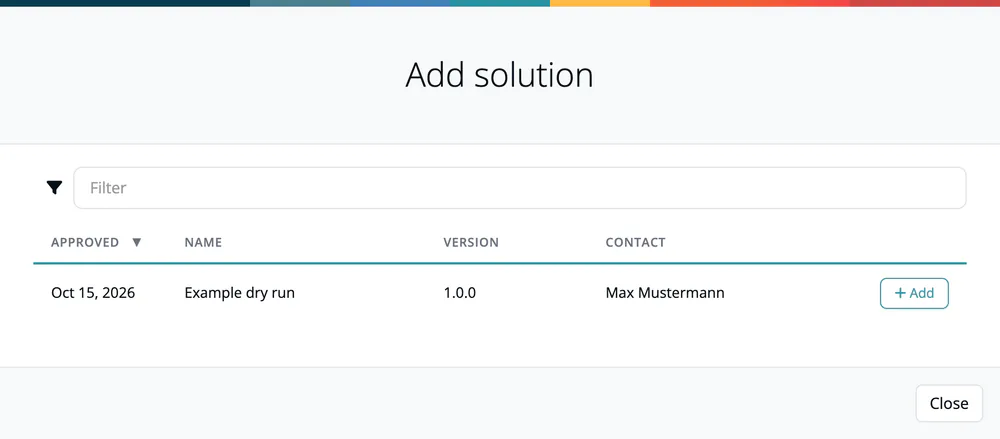

# Linking a Product with a Release

> [!NOTE]
> **Required license feature:** `products`

The connection between products and your actual software happens through **solutions**: approved releases that you link to a product.

## How it works

1. A module goes through the [approval workflow](../06-approvals/index.md) and is **approved**.
2. The approved module becomes a **release** with a frozen snapshot.
3. On the product's [Solutions tab](03-tab-solutions.md), click **Add solution**.
4. Click **Add** next to the approved release in the list.
5. The capabilities recorded for that approval (name, version, description) are copied to the solution; the Solutions tab lists their names in the **Capabilities** column.

## Why this matters

The product-to-release link creates the traceability chain required by the EU CRA:

```
Product (what you ship)
  └── Solution (approved release)
        └── Module (what you build)
              └── Components (what's inside)
```

At any point you can trace from a customer-facing product down to the individual components and their licenses, vulnerabilities and obligations.



## Related

- [Approvals](../06-approvals/index.md) - the approval workflow that creates releasable snapshots
- [Releases](../07-releases.md) - managing published releases
- [Solutions tab](03-tab-solutions.md) - viewing linked releases on a product
