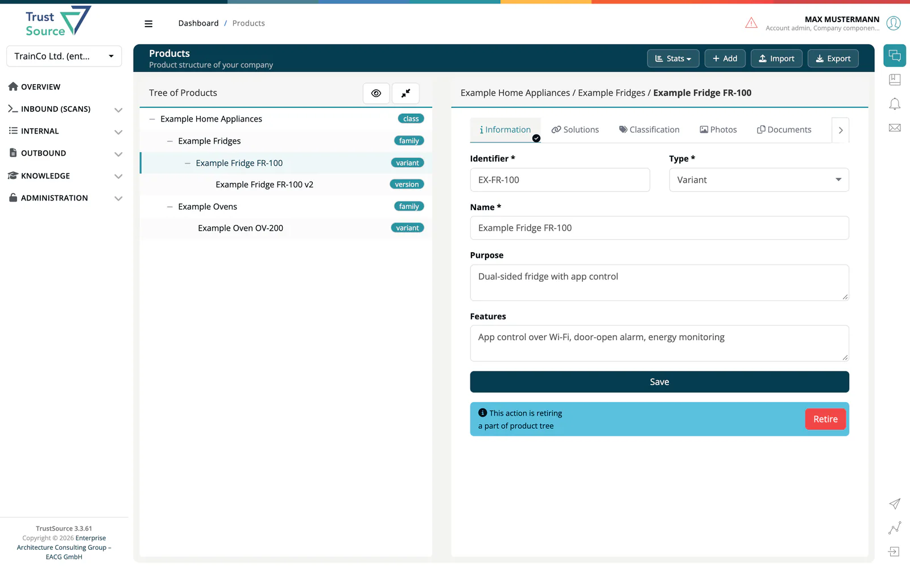

# Products

> [!NOTE]
> **Required role:** `developer`, `compliance_manager`, `manager` or `account_admin`
> **Required license feature:** `products`

A **product** in ***TrustSource*** represents what you ship to the customer. Products are particularly important for **EU Cyber Resilience Act (CRA)** compliance: they carry the CRA classification, contacts, documentation and misuse cases.

## Products vs. Modules

- A **module** is what you *build* (code, dependencies, scans).
- A **product** is what you *ship* (packaging, classification, documentation, contacts).
- Products link to modules via **solutions**, the approved releases that make up the product.

## Product detail tabs

| Tab | What it contains |
|---|---|
| [Information](02-tab-information.md) | Identifier, type, name, purpose and features; retire and revert. |
| [Solutions](03-tab-solutions.md) | Approved releases linked to this product. |
| [Classification](04-tab-classification-cra.md) | CRA classification (STANDARD, IMPORTANT Class 1, IMPORTANT Class 2, CRITICAL). |
| [Photos](05-tab-photos.md) | Product photo gallery. |
| [Documents](06-tab-documents.md) | User manual, secure setup guide, product description, SBOM, CE mark declaration. |
| [Contacts](07-tab-contacts.md) | Manufacturer info, PSIRT contact. |
| [Support](08-tab-support.md) | Support contracts with end dates; EoL info file. |
| [Misuse](09-tab-misuse.md) | Potential misuse cases required by the CRA. |

## Related

- [Link with Release](10-link-with-release.md) - how to connect an approved release to a product
- [Background: Cyber Resilience Act](../../../shared/background/01-cra-cyber-resilience-act.md)
