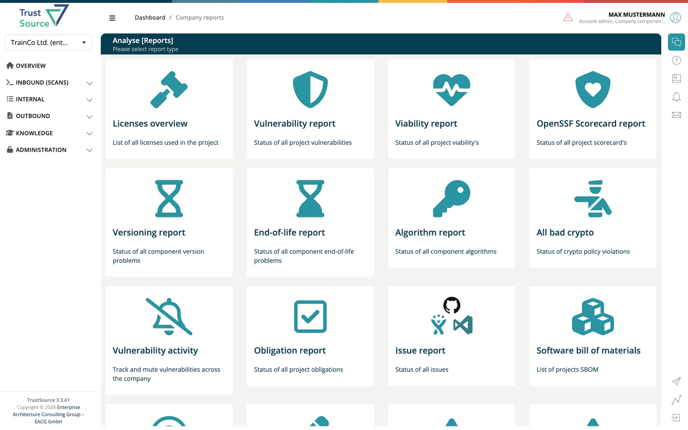

# Reports

> [!NOTE]
> **Required role:** `developer`, `compliance_manager` or `manager`. **Reports** is an entry of the **Internal** menu, which is shown to these three roles. Some tiles need further roles, see the table.

The Reports page (titled **Analyse [Reports]** in the app) is a hub of 22 tiles. Each tile opens a report in ***TrustSource***. The SBOM, Notice and SOUP tiles lead to the same lists as the [Outbound chapter](../04-outbound/index.md).

## Report tiles

| Tile | Shows |
|---|---|
| **[Licenses overview](04b-analysis-reports.md#licenses-overview)** | All licenses used. |
| **[Vulnerability report](04a-vulnerability-report.md)** | Status of all vulnerabilities. |
| **[Viability report](04b-analysis-reports.md#viability-report)** | Viability status of components. |
| **[OpenSSF Scorecard report](04b-analysis-reports.md#openssf-scorecard-report)** | Scorecard status of components. |
| **[Versioning report](04b-analysis-reports.md#versioning-report)** | Component version problems. |
| **[End-of-life report](04b-analysis-reports.md#end-of-life-report)** | Component end-of-life problems. |
| **[Algorithm report](04b-analysis-reports.md#algorithm-report)** | Algorithms used by components. |
| **[All bad crypto](04c-impact-and-portfolio-reports.md#all-bad-crypto)** | Crypto policy violations. Roles: `company_security_manager`, `compliance_manager`, `portfolio_manager`. |
| **Vulnerability activity** | Track and mute vulnerabilities across the company. Role: `company_security_manager`. |
| **[Obligation report](04b-analysis-reports.md#obligation-report)** | Obligations of all projects. |
| **[Issue report](04c-impact-and-portfolio-reports.md#issue-report)** | Tasks from your issue tracker (Jira, GitHub, TFS). |
| **Software bill of materials** | List of SBOMs. |
| **[Credits report](04b-analysis-reports.md#credits-report)** | Credits of projects. |
| **[Modification state](04b-analysis-reports.md#modification-state)** | Modified components. |
| **[Component impact](04c-impact-and-portfolio-reports.md#impact-reports)** | Projects impacted by a component. Roles: `compliance_manager`, `manager`, `portfolio_manager`. |
| **[CVE impact](04c-impact-and-portfolio-reports.md#impact-reports)** | Projects impacted by a CVE. |
| **[Algorithm impact](04c-impact-and-portfolio-reports.md#impact-reports)** | Projects impacted by an algorithm. |
| **Notice files** | List of Notice files. |
| **SOUP files** | List of SOUP files. Shown with the `medical` license or when SOUP reports are part of your plan. |
| **[COTS overview](04c-impact-and-portfolio-reports.md#cots-overview)** | COTS components in projects. Same condition as SOUP files. |
| **[Dependent projects](04c-impact-and-portfolio-reports.md#dependent-projects)** | Projects that depend on a selected project. |
| **[Components](04c-impact-and-portfolio-reports.md#components)** | Components with missing data. Role: `company_component_manager`. |

Open a project's or module's own **Reports** dropdown to start a report with that project preselected.

The tiles you see depend on your role and license. CSAF documents are not part of this hub; find them under [Outbound → CSAF](../04-outbound/04-csaf.md).

## Details

- [Analysis Reports](04b-analysis-reports.md): single project or module: licenses, viability, Scorecard, versioning, end-of-life, algorithms, obligations, credits, modification state
- [Impact and Portfolio Reports](04c-impact-and-portfolio-reports.md): impact of a component, CVE or algorithm, bad crypto, COTS, dependent projects, issues

## Related

- [Vulnerability Report](04a-vulnerability-report.md): CVSS vs. EPSS chart and treatments
- [Outbound chapter](../04-outbound/index.md): SBOM, Notice, SOUP and CSAF documents
- [Approvals](06-approvals/index.md): an approval request generates its own compliance report, Notice, SoUP and SBOM
