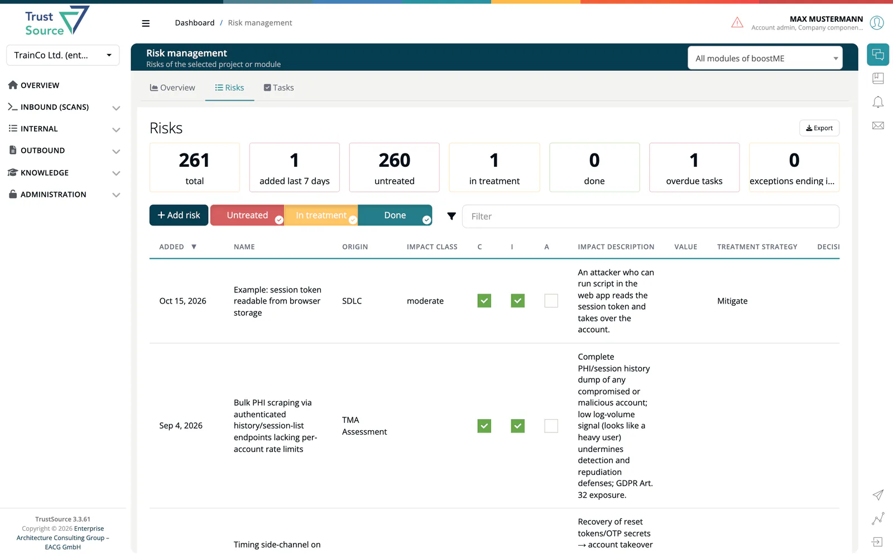

# Risks List

> [!NOTE]
> **Required role:** `developer`, `compliance_manager`, `manager` or `account_admin` to view. The **Add risk** button and the treatment group buttons are shown to `compliance_manager` and `manager` only.
> **Required license feature:** `risks`

The **Risks** tab is the register: one row per risk, for the whole company or for the project or module you choose. Click a row to open the risk in the editor.

## Choose what the list shows

Use the selector at the top right:

- **All projects**: every risk of the company. Above 5,000 risks the list shows the 5,000 newest, with a note; choose a project to see the rest.
- **All modules of** a project, or a single module.

On a project's own Risks page (the Risks tile on the project page) the project is fixed and you can only narrow down to one of its modules. That page also lists the project's threat models if your plan includes the `threat` feature.

## Tiles

The tiles count the risks in scope: **total**, **added last 7 days**, the three treatment groups **Untreated**, **In treatment** and **Done**, **overdue tasks**, and **exceptions ending in 30 days**. The three groups always add up to the total. See [Treatment and State](05-treatment-and-state.md).

## Filter the list

- Switch the **Untreated**, **In treatment** and **Done** buttons on or off to show or hide a group (shown to the `compliance_manager` and `manager` roles).
- Use the search box above the table to filter by any text.
- Links from the [Overview](01-overview.md) open the list with a filter, shown as chips such as *State: assessed*. Click **Clear filter** to remove them.

## Columns

*Added*, *Name*, *Origin*, *Impact class*, *C*, *I* and *A* (the confidentiality, integrity and availability boxes), *Impact description*, *Value* (the annual loss expectancy), *Treatment strategy*, *Decision*, *Valid until*, *Countermeasures*, *State* and *Treatment*. An impact class that your [scheme](07-risk-assessment-scheme.md) no longer contains is kept and marked **not in scheme**. Impact classes sort by their rank in the scheme.

When you look at a project, the risks that belong to one of its modules show **in Module** instead of a delete button. Click the label to open the module's own list; these risks can only be edited and removed there. A module's list shows only the module's own risks, not those of its project.

The trash button at the end of a row removes the risk at once, without a confirmation. The removal is recorded in the risk's history and in Company Logs.

## Export

**Export** downloads the listed risks as a CSV file named `risk-register-<date>.csv`. It contains the rows of the current selection with the group buttons and the filter chips applied; the text typed in the search box is not applied.

## Add a risk

1. Select a project or module (the **Add risk** button is hidden in the company-wide list).
2. Click **Add risk**. The **Risk capture** form opens.
3. Enter a **Name** (3 to 200 characters), choose one or more **Origin** values and describe the impact.
4. Tick the affected **Confidentiality**, **Integrity**, **Availability** boxes, pick an **Impact class** and a **State**. Optionally fill in the impact figures and the **Threat model context**.
5. Click **Save**, or **Save and Create new one** to add the next risk.

A risk can also start from a finding: **Create risk** on a SARIF finding, on an OBOM finding, or by setting a license by hand. See [Automatic Risks](08-automatic-risks.md).

## The risk editor

Click a row to open a risk. The header keeps **Save**, the previous/next arrows with a position counter and **Back to list**. The address bar names the open risk, so you can share the link.

The top row holds **Name**, **Origin**, **Impact class**, **Treatment strategy** and **State**. The tabs below are:

| Tab | What it holds |
|---|---|
| **Impact** | The C/I/A boxes, the description of the impact and the financial figures. |
| **Decision** | The documented decision. See [Decisions](06-decisions.md). |
| **Countermeasures** | What you do about the risk. See [Risk Tasks](03-risks-tasks.md). |
| **Tasks** | Follow-up tasks per countermeasure. |
| **Threat model** | STRIDE categories, CWEs, ENISA category and threat, affected element type, trust boundary crossing, TM method, TM run ID and OTM threat ID. |
| **Occurrences**, **Affected components**, **Affected resources** | Only on automatically created risks: the evidence behind them. |
| **History** | Every change. See [Risk History](09-risk-history.md). |

### Impact figures

Switch between **Simple impact view** and **Detailed impact view**.

- **Simple**: choose **Business value (BV)**, **Exposure factor (EF)** and **Annual rate of occurrence (ARO)** from the lists of your scheme (by default low, moderate, high and likely, unlikely, rare).
- **Detailed**: enter BV in your company currency, EF in percent and ARO per year. ***TrustSource*** calculates **SLE = EF * BV** and **ALE = SLE * ARO**.

### Proposed impact class

Risks created from a SARIF weakness, a vulnerability or a manually set license carry a proposed impact class, derived from the finding's severity and the module's CIA requirements. The form shows the proposal and what it is based on, and tells you when it differs from the stored class. Change the class once and later imports keep your choice; only the proposal beside it is refreshed.

> [!NOTE]
> A module's risk opened from the project register is read-only and shows **This risk is managed in module level**. Open it from the module to edit it.

## Related

- [Treatment and State](05-treatment-and-state.md) - strategy, state and the three groups
- [Risk Tasks](03-risks-tasks.md) - countermeasures and tasks
- [Risk History](09-risk-history.md) - the change trail
