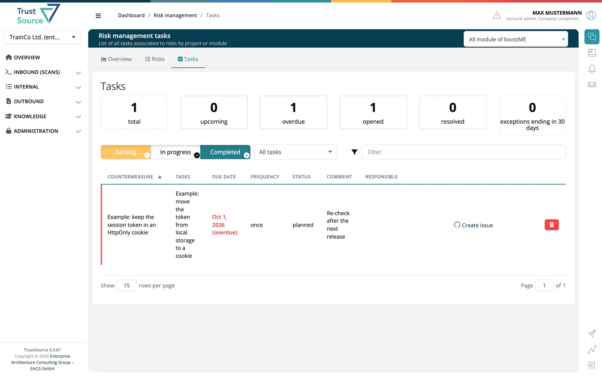

# Risk Tasks

> [!NOTE]
> **Required role:** `developer`, `compliance_manager`, `manager` or `account_admin`
> **Required license feature:** `risks`

A risk is worked off through **countermeasures** (what you do about it) and **tasks** (the concrete steps, with an owner and a due date). The **Tasks** tab lists all tasks of the risks in one project or module.

## Countermeasures

Open a risk, then the **Countermeasures** tab, and click **Add countermeasure**.

| Field | Description |
|---|---|
| **Name** | 3 to 200 characters, for example *Use parameterised queries for all DB access*. |
| **Status** | identified, planned, completed, ok, required, not-required or verified. |
| **Comment** | Free text. |
| **Responsible** | One or more users. |
| **Risk reduction (%)** | 0 to 100. |
| **Standard reference** | For example *OWASP-ASVS V5.3.4*. |
| **Validation method** | How you prove it works. |
| **OTM mitigation ID** | Links the countermeasure to a threat-model mitigation. |

**Save and Create new one** keeps the dialog open for the next entry. The trash button removes a countermeasure.

## Tasks

On the risk's **Tasks** tab, click **Add task**. The **Add a task** dialog has these fields:

| Field | Description |
|---|---|
| **Countermeasure** | Required. The task belongs to it. |
| **Name** | Required. What has to be done. |
| **Status** | backlog, planned, in_progress, in_review or completed. |
| **Due date** | A day, counted in UTC. |
| **Frequency** | Free text such as *quarterly*. |
| **Comment** | For example *Re-check after each release*. |
| **Responsible** | One or more users. |

Each task row also offers **Create issue**, which opens a GitHub issue from the task, and **View issue** once it exists. Without a GitHub integration, or when the project or module has no repository set, the link reads **Copy details** and copies the task text to the clipboard.

## The Tasks tab

1. Open **Risks → Tasks**.
2. Choose a project or module at the top right (**Select report target**). Until you do, the page only asks you to select a project.
3. Read the tiles: **total**, **upcoming** (due within 7 days), **overdue**, **opened** (planned, in progress or in review), **resolved** and **exceptions ending in 30 days**.
4. Use the buttons **Backlog**, **In progress** and **Completed** to show or hide groups, and the selector **My tasks**, **Unassigned** or **All tasks**.

A task is **overdue** when it is not completed and its due date lies before today. Overdue tasks carry *(overdue)* after the date and a coloured row. A task due today is not yet overdue.

## Reminders

- When a task becomes overdue, its responsible users receive one message and one e-mail.
- 14 days before a [temporary exception](06-decisions.md#temporary-exceptions) ends, the decision maker and the responsible users are notified once.

Each reminder is sent at most once per event: a task whose due date is moved and missed again, or an exception that is renewed, is reminded again. If sending fails, it is logged and not repeated. Users are only notified if they hold a role in the company. The check runs regularly in the background (by default every hour).

## Related

- [Risks List](02-risks-list.md) - the risk editor
- [Decisions](06-decisions.md) - temporary exceptions
- [Integrations](../../06-administration/08-integrations.md) - set up GitHub, Jira or TFS
