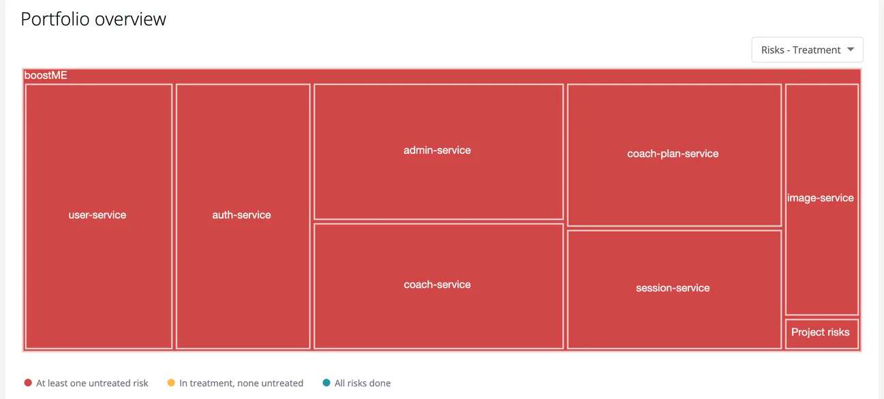

# Portfolio Views

> [!NOTE]
> **Required role:** `developer`, `compliance_manager`, `manager` or `account_admin`
> **Required license feature:** `risks`

The **Portfolio overview** on the [Overview](01-overview.md) tab is a treemap of your projects and modules. The size of a rectangle is the number of risks; its colour tells you where to look first.

## Choose the colouring

Use the **View type** selector above the chart:

| View | Red | Amber | Teal |
|---|---|---|---|
| **Risks - Treatment** | At least one **Untreated** risk | In treatment, none untreated | All risks **Done** |
| **Risks - Impact** | A critical or existential risk | A high or moderate risk | Low or no impact class only |

A colour legend sits under the chart, so colour is never the only signal.

## Explore

- **Hover** a rectangle for the count and the number of risks per group.
- **Click a project** to zoom into its modules. **Back to all** returns to the whole portfolio.
- **Click a module** to open its risks in a new tab.

With more than 100 entries the chart shows projects only until you zoom in.

## Related

- [Risk Overview](01-overview.md) - the rest of the dashboard
- [Treatment and State](05-treatment-and-state.md) - what the colours mean
