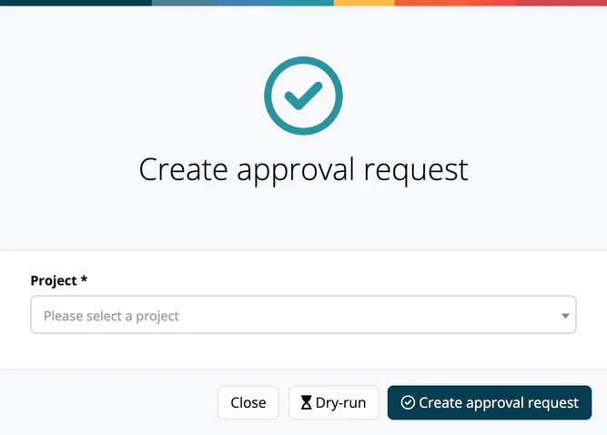

# Requesting an Approval

> [!NOTE]
> **Required role:** `manager` or `compliance_manager`. The entry points below are shown to these two roles; other roles get a `403` when they try to start a real request. A **dry run** (a draft) is accepted from every member of the company.

You request an approval for a project and choose which of its modules, in which analysis version, go into it. A five-step wizard guides you.

## Start the wizard

- **From the approvals list:** click **Create**, choose the **Project** and click **Create approval request**, or **Dry-run** to try it out. The list offers every project you can see: projects without members, and projects where you are a member or default manager (portfolio managers: all projects).
- **From a project:** click **Start approval** on the project's **Releases** tile or on the project's releases page.
- **From a module:** click **Initiate approval** in the module header. The wizard opens with that module preselected.

## The five steps

| Step | What you do |
|---|---|
| **1 Settings** | Under **Prepare Approval**, enter the **Approval Name** (required), an optional **Semantic version** (only the version of the approval, not of your product), a **Packageurl** (a valid PURL, used by the public VEX lookup) and an **Approve description** for the compliance manager. Tick **Dry run** to see the results without sending the request to the compliance managers. |
| **2 Pick modules** | All modules of the project are ticked at first; untick those that do not belong to the release. The table shows each module's state, name, components, legal, security and quality figures. |
| **3 Select analysis** | Choose the analysis (scan version) of each module. You can search by branch or tag. |
| **4 Confirm statuses** | Check state, analysis and the figures once more, then click **Next** to create the request. |
| **5 Finalization** | The request is created at once and the documents are generated in the background. |

Only modules of the same project that you can see can be selected, each with one of its own analyses.

## Finalization

The last step, **Finalizing your approval request**, shows one row per document, in this order: **Compliance Report**, **SoUP**, **Notice** and **SBOM**. Each row has its own progress bar and, as soon as the document is ready, a link to open it. SoUP shows *Not applicable* when SoUP reports are not part of your plan. The SBOM is built from the scan pinned in the approval.

- **Done:** *Great! You made it!* A normal request has been forwarded to the compliance managers of your organisation. Compliance managers and followers of the project who have approval events enabled in their notification settings are notified. A dry run is not sent to anyone: it is assigned to you and shows as **Draft** under **Internal → Approvals**, where compliance managers can see it too.
- **Failed:** *Report generation did not finish*, with the details. The approval request itself still exists; open the reports that were generated or jump to the Compliance Report, and contact support if this keeps happening.

Use **Jump to Compliance Report** to open the approval, or **Return to project**.

## What the approval contains

When the request is created, ***TrustSource*** generates and attaches:

- the **compliance report** (the data behind the review tabs),
- the **Notice file**: attribution document for all components,
- the **SBOM**: a snapshot of the bill of materials,
- the **SoUP file**: list of Software of Unknown Provenance (only when SoUP reports are part of your plan).

These documents are frozen with the approval.

## Turn a dry run into a request

Open the draft from the approvals list. A `compliance_manager` sees **Create approval request** in the header and confirms with *Yes, create it!*; the draft is replaced by a real request. **Remove DRAFT** deletes the dry run.

## Related

- [Approval Detail Tabs](02-approval-detail-tabs.md): what the reviewer sees
- [Approve / Reject](03-approve-reject-workflow.md): the decision workflow
- [Binary Linking](04-binary-linking.md): binary references of the approval
