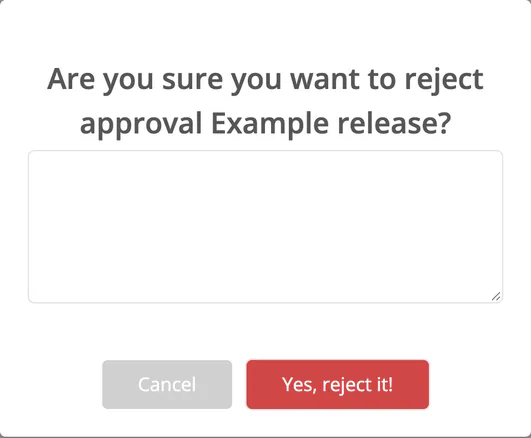

# Approve / Reject Workflow

> [!NOTE]
> **Required role:** only `compliance_manager` sees the **Approve** and **Reject** buttons. Over the API, approving and rejecting need an API key with the `compliance_manager` scope.

## Where you decide

You can decide in two places: on a row of the approvals list, or in the header of the approval after you have reviewed its tabs. Both show the same two buttons for requests that are not drafts and not yet closed.

### Take the request

The list column **Assigned to** shows who owns the request. A compliance manager clicks **assign to me** to take it, or the name with the cross to hand it back. Assignments are written to the [Audit Logs](../../06-administration/07-audit-logs.md).

## Approving

1. Review the tabs.
2. Click **Approve** and confirm *Yes, approve it!* The dialog warns *You will not be able to revert this!*
3. The approval is closed and shows the **Approved** badge.

What happens on approval:

- The approval date and approver are recorded and shown on the **Approved** badge.
- The scans and analyses of the approved modules are marked as released.
- A **public release key** is created and published for the approval. While a published key serves the approval, approving it again (for example through the API) returns that key instead of adding another. The key serves the SBOM, notice and CSAF documents of the release; see [Release keys](../../06-administration/04b-release-keys.md).
- Managers who have approval events enabled in their notification settings receive an in-app message, and an e-mail if they receive events by e-mail. The webhook triggers `approval` and `release` fire.
- The approval appears under [Releases](../07-releases.md) and can be [linked to a product](../03-products/10-link-with-release.md) as a solution.

Over the API, `GET /compliance/approvals/{approval_id}` returns the status, who closed the approval and, once it is approved, the release key with its URLs; see [Compliance approvals](../../09-rest-api/endpoints/compliance-approvals.md).

## Rejecting

1. Review the tabs and identify issues.
2. Click **Reject**.
3. Enter a **rejection reason** in the dialog and confirm *Yes, reject it!* A reason is required: without one you get *You are not allowed to reject without reason!*
4. The approval is closed with the **Rejected** badge. In the list, hover over the badge to read the reason; on the approval, open the badge.

Managers who have approval events enabled are notified with the reason, and the webhook trigger `approval` fires. The project manager can address the issues and submit a new approval request.

> [!NOTE]
> Once approved or rejected, the app no longer offers **Approve** or **Reject** for the request, and the binary links of an approved request can no longer be edited in the app. This keeps the audit trail intact.

## Related

- [Approval Detail Tabs](02-approval-detail-tabs.md): what to review
- [Releases](../07-releases.md): what happens after approval
- [Public Approves](05-public-approves.md): sharing the release documents
