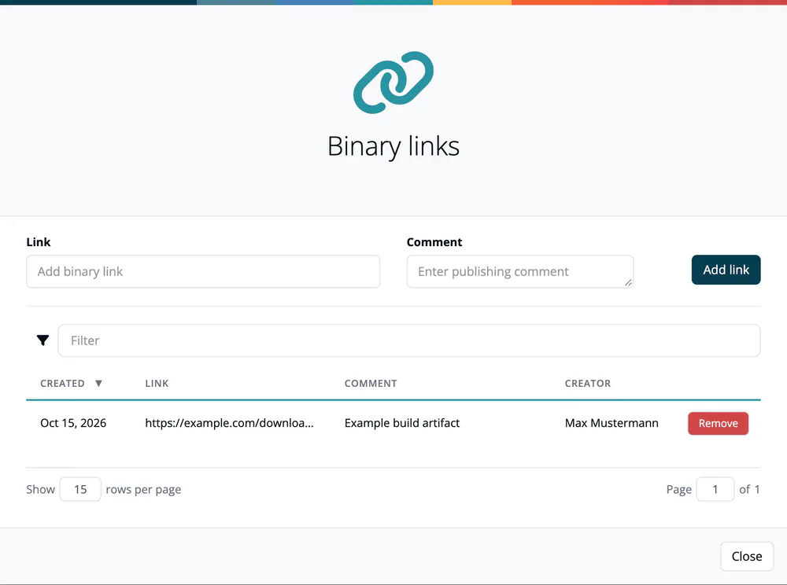

# Binary Linking

> [!NOTE]
> **Required role:** `manager` or `compliance_manager` to add or remove links.

Binary linking lets you attach references to compiled artifacts (JARs, Docker images, binaries) to an approval. This creates a traceable connection between the source-level bill of materials and the actual artifact you ship.

## Where the links come from

- **From the scan:** binary links recorded with a scan or analysis are copied into the approval for the analysis you pick in the [approval wizard](01-request-approval.md#the-five-steps).
- **On the approval:** click **Manage binary links** in the approval header. The dialog **Binary links** lists every link with **Created**, **Link**, **Comment** and **Creator**. Enter a **Link** and an optional **Comment**, then click **Add link**. **Remove** deletes a link after you confirm *Yes, remove it!*

Once the approval is approved, the dialog is read-only. On the [release](../07-releases.md), **Binary links** shows the same list.

## Related

- [Requesting an Approval](01-request-approval.md): choosing the analyses whose binary links are carried over
